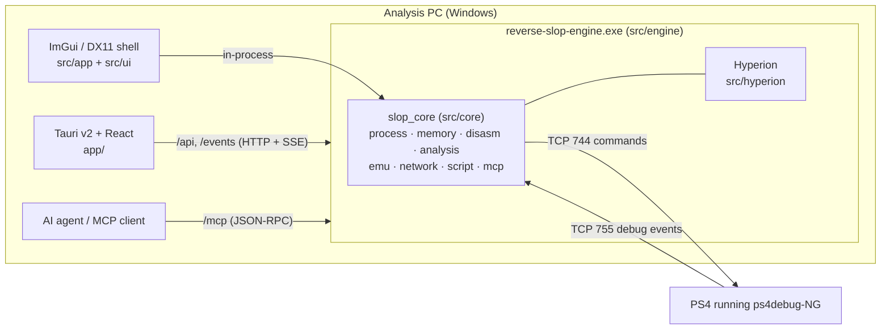

<p align="center">
  
</p>

<h1 align="center">SlopStation</h1>

<p align="center">
  <b>PS4 reverse-engineering workbench</b><br/>
  live memory, scanning and debugging over ps4debug-NG · static analysis of dumped modules ·
  a decompiler and x86-64 emulator · Lua scripting · a built-in MCP server for AI agents
</p>

<p align="center">
  <a href="https://github.com/NetVar1337/SlopStation/actions/workflows/build.yml"></a>
  
  
  
  
</p>

> [!WARNING]
> Use SlopStation only on consoles, games, and systems you own or are authorized to test.
> Live debugging and memory writes can crash the console or the game. Host-side packet
> capture needs administrator rights on the analysis PC.


<sub>Screenshots were captured from the real UI against the bundled
[`SlopTarget`](src/target) fixture over the local user-mode backend — every address and
value is genuine runtime data. Console-only views are shown in their waiting state.</sub>

---

## What it is

SlopStation is a Windows workbench for PS4 reverse engineering and game research. It
speaks the [ps4debug-NG](https://github.com/Pharaoh2k/ps4debug-NG) wire protocol directly,
runs the same analysis stack against local Windows processes, and exposes everything —
live memory, the debugger, the scanner, the decompiler, the emulator, the network tools —
through one UI, one Lua surface and one MCP server.

| Area | Summary |
| --- | --- |
| **Console connection** | ps4debug-NG over TCP 744 plus the TCP 755 debug-event callback. Auto-discovery, auto-connect, reconnect with backoff, native/turbo scan and bulk writes. |
| **Live memory** | Regions, modules, threads, read/write/protect/alloc, Cheat Engine-style scans, AOB wildcards, pointer chains, snapshots and diffs, a shared watchlist with freeze/freeze-once/undo. |
| **Live debugging** | Software breakpoints (conditional, hit counts), DR0–DR3 watchpoints, continue/step/suspend, stop events with registers, callstacks, FP/FS-GS, remote calls, trace/find-write one-shots. |
| **On-console tooling** | Native scan/rescan, Turbo Scan, verified bulk writes, fork module/snapshot commands, Zydis disassembly, xrefs, Keystone assembly, ELF upload. |
| **Static analysis** | ELF64 with NID→name resolution, SELF, PE, Mach-O/`.ipa`, .NET; function/xref/string indexes; Xray passes; patching with a journal; binary diffing; packer heuristics. |
| **Decompiler** | Hyperion p-code lifting, SSA, DCE, type inference and structuring to C-like output (SysV AMD64, Win64, AAPCS64). |
| **Emulation** | Isolated Unicorn x86-64 runs with demand paging from the loaded image or live memory, tracing, byte-level taint and devirtualization helpers. |
| **Automation** | Lua 5.4 against the shared session, plus an MCP server with action-based tools, task playbooks (`guide`), a JSONL audit log and an optional confirm gate. |
| **Payload host** | Built-in HTTP payload host with a sha256 `manifest.json`; UDP broadcast discovery; the bundled ps4debug-NG payload. |
| **Host network** | Raw-socket capture, DNS log, stream reassembly, PCAP export, and a localhost HTTP inspection proxy. |

Two desktop shells drive the same C++ core: the **Tauri v2 + React** app (the one that
ships) and a legacy **ImGui/DX11** shell. The engine also runs headless for MCP/HTTP
clients only.

## Install

### Installer (recommended)

Download `SlopStation_<version>_x64-setup.exe` from
[Releases](https://github.com/NetVar1337/SlopStation/releases/latest) and run it. The
installer is per-user — no administrator prompt — and installs the app, the engine, the
bundled ps4debug-NG payload and the optional Magicmida sidecars.

**Auto-update is on by default.** On launch the app checks the latest GitHub release,
downloads the signed installer in the background and offers **Install & restart** in the
banner. **Settings → Updates** shows the running version and a manual check. Updates are
verified against the embedded Tauri public key; the installer is Authenticode-signed when
the signing secrets are configured.

### Portable single file

`SlopStation.exe` from the release zip is self-contained: the engine is embedded in the
executable and extracted to `%LOCALAPPDATA%\dev.slopstation.ui\engine` on first run. No
installer, no sidecar folder. The payload card can download the latest ps4debug-NG
release on demand.

### Requirements

| Needed for | Requirement |
| --- | --- |
| Running the app | Windows 10/11 x64, WebView2 runtime (bundled with Windows 11) |
| Console work | A PS4 on the same network running the ps4debug-NG payload |
| Building | Visual Studio 2022+ with _Desktop development with C++_, CMake ≥ 3.25, Ninja, Node.js + npm, Rust/Cargo |
| Optional | Administrator rights for host packet capture; Magicmida for Themida unpacking |

## Quick start

1. **Launch SlopStation.** The splash waits for the engine handshake (up to 180 s, which
   covers the UAC prompt on first run).
2. **Load the payload on the PS4.** In **Targets**, the *ps4debug-NG payload* card shows
   the bundled release. **Save payload…** writes `ps4debug-ng.bin` wherever you want;
   send it with BinLoader (port 9090), FTP or your GoldHEN payload loader. **Check
   latest** compares the bundled build with the newest GitHub release; **Download**
   fetches a newer one.
3. **Connect.** Enter the console IP (port 744) and press **Connect**, or let an agent do
   it in one call:

```json
{ "tool": "target", "action": "ps4_auto", "params": { "host": "192.168.1.50" } }
```

`ps4_auto` connects, authenticates the native scanner, picks the game process (the one
with `/app0/` modules, eboot-named preferred), attaches a session and the debug session,
and returns modules, threads and regions.

No console handy? Click **“List this PC’s processes instead”** in Targets and attach to
any local process — everything except the `ps4_*` actions works.

## Feature map

### Console connection (ps4debug-NG)

- `target.ps4_connect {host, port=744, pid?}`, `ps4_disconnect`, `ps4_reconnect`,
  `ps4_auto`, `ps4_discover` (UDP broadcast), `ps4_dump_module`.
- Reads are validated against the console VM map, so unmapped ranges fail instead of
  returning zeros. Windows `PAGE_*` constants are translated to FreeBSD `VM_PROT_*`.
- The port-755 listener accepts only the attached console and drains each connection on
  its own thread.

### Live memory

- Read/write in hex, UTF-8, integer and float formats; allocate, free, change protection.
- Initial and refined numeric scans: exact/range/changed/unchanged, signed/unsigned/float
  widths, rounding, region/protection/alignment filters, worker/chunk/result caps.
- AOB wildcard search, pointer-chain scans and verification, signature generation, live
  crypto-constant search.
- Memory snapshots with compare/list/free; `scan_save`/`scan_load` persist an address-list
  scan across restarts.
- Shared watchlist sampled about 10 Hz with freeze writes; UI and MCP edits appear in
  both. `watch_freeze_once` releases after the first write-back and `watch_undo` restores
  the captured value.

### Live debugging

| Group | Actions |
| --- | --- |
| Session | `ps4_attach {pid}`, `ps4_detach`, `ps4_status` |
| Breakpoints | `ps4_bp_set {addr, condition?, hits?}`, `ps4_bp_clear`, `ps4_bp_list` (slots 0–29) |
| Watchpoints | `ps4_watch_set {addr, len, type}`, `ps4_watch_clear`, `ps4_watch_list` (DR0–DR3) |
| Run control | `ps4_continue`, `ps4_step`, `ps4_suspend`/`ps4_resume`, `ps4_process_stop` |
| Events | `ps4_wait {timeout_ms}`, `ps4_events {max, clear}` |
| Registers | `ps4_regs`, `ps4_set_reg`, `ps4_dbregs`, `ps4_set_dbregs`, `ps4_fpregs`, `ps4_fsgs` |
| Stack | `ps4_callstack`, `ps4_stack` |
| Remote calls | `ps4_call {addr, args[6]}` — installs the payload RPC stub once per process |
| Power actions | `ps4_until`, `ps4_find_write`, `ps4_trace_calls`, `ps4_trace_steps` |

### On-console tooling (runs inside the payload)

- **Turbo Scan & bulk writes**: `ps4_turbo_caps`, `ps4_turbo_regions`, `ps4_turbo_config`,
  `ps4_turbo_scan`, `ps4_turbo_rescan`, `ps4_turbo_results`, `ps4_turbo_cancel`,
  `ps4_turbo_end`, and `ps4_write_multi` (up to 65,535 verified writes in one round-trip).
- **Fork extensions**: `ps4_modules` (server-side module list) and `ps4_snapshot`
  (one-round-trip region stream); `target.modules` uses `CMD_PROC_MODULES` with a
  client-side fallback on upstream payloads.
- **Native scan** (unlocked by `ps4_auth`): `ps4_scan`, `ps4_rescan`, `ps4_scan_state`,
  `ps4_scan_reset`, `ps4_scan_all`, `ps4_scan_aob` (`??` wildcards).
- **Code analysis**: `ps4_disasm`, `ps4_xrefs`, `ps4_xrefs_to`.
- **Assembly**: `ps4_assemble {asm, base?, syntax?}` (payload-side Keystone).
- **ELF upload**: `ps4_elf_rpc {path}`, `ps4_elf_load {path}`.
- **Console**: `ps4_notify`, `ps4_print`, `ps4_app` (foreground pid, title ID, content ID).

### Static analysis

- ELF64 with **NID→name resolution** (built-in database, overridable via
  `%LOCALAPPDATA%\reverse-slop\nids.txt`) and relocation application; SELF header/segment
  extraction; PE headers/imports/exports; Mach-O thin/FAT and `.ipa`; .NET metadata.
- Fast Zydis function, xref and string indexes; Capstone for ARM64.
- Background Hyperion analysis (CFGs, globals, vtables, RTTI, names) and the decompiler
  for PE and Mach-O images; .NET assemblies list types, render C#, or dump IL.
- **Xray** (read-only): CFG and cyclomatic complexity, control-flow flattening and
  obfuscation scoring, string reconstruction, indirect-call recovery, anti-analysis
  patterns, hook checks, direct syscalls, API-hash resolution, entropy windows, page
  classification, crypto constants, ROP gadgets.
- **Patching** (loaded image only): junk-NOP cleanup, opaque predicates, anti-debug, XOR
  unpack, string decoding, byte writes, a patch journal with full revert, a combined pass,
  and re-indexing after edits.
- Binary-to-binary function diff, packer/protector indicators, RTTI/vtable recovery,
  dangerous-import callsites, library signatures, user structs/enums, comments and
  bookmarks. Names/comments/bookmarks persist per file hash and remap across bases.

### Emulation and devirtualization

- Unicorn x86-64 runs from bytes, loaded-image addresses or live target addresses, with
  demand paging, IAT stubs that log calls, custom registers/stack/memory, stop conditions,
  bounded traces and byte-granular taint.
- VM identification, handler discovery, opcode maps, trace/lift/pseudocode, CFG recovery,
  predicate proofs, invariants and IAT audits.
- Supervised Magicmida (Themida) jobs with architecture checks, cancellation and timeouts.

### Host network and proxy

- Raw-socket capture on the analysis PC (SIO_RCVALL, administrator): packet paging with
  text filters, DNS log, statistics, stream listing and reassembly, per-packet
  HTTP/TLS/DNS inspection, PCAP export.
- Independent localhost HTTP/1.1 proxy: start/stop, captured exchanges, replay. CONNECT
  tunnels record metadata and SNI only; TLS interception (`mitm_enable`) requires explicit
  consent, installs a local CA, and is fully reversible (`mitm_uninstall`).

### Persistence, filesystem and web

- SQLite session snapshots and key/value storage; Hyperion `.hdb` export/import.
- Host filesystem read/write/list/create/delete/search/grep (the engine data dir is
  refused).
- Outbound WinHTTP GET/POST without browser-cookie inheritance; private/loopback targets
  are denied unless explicitly allowed.

## Screenshots

**Workspace** — scanner results, a live watchlist, disassembly and inspector on the bundled fixture.

<table>
<tr>
<td width="50%"><br><b>Disassembly</b> — virtualized function list with flow-coloured instructions and jump following.</td>
<td width="50%"><br><b>Strings</b> — string index with min-length / exec-section filters; click to follow xrefs.</td>
</tr>
<tr>
<td width="50%"><br><b>Memory</b> — region list and a 4 KiB-paged hex editor, editable in place.</td>
<td width="50%"><br><b>Lua scripts</b> — scratchpad (`Ctrl+Enter`) against the same session as the UI and MCP.</td>
</tr>
<tr>
<td width="50%"><br><b>PE browser</b> — sections, imports, exports of the loaded image.</td>
<td width="50%"><br><b>Command palette</b> — `Ctrl+K` jumps to functions, addresses, tabs and actions.</td>
</tr>
<tr>
<td width="50%"><br><b>Settings</b> — theme, motion, engine endpoints, MCP token policy, updates, Lua sandbox.</td>
<td width="50%"><br><b>Themes</b> — Nord-slop shown; also Obsidian (default), Blood-orange, Daylight, High-contrast.</td>
</tr>
<tr>
<td width="50%"><br><b>Debugger</b> — registers, callstack, breakpoints, watchpoints and the event feed once a console is attached.</td>
</tr>
</table>

## Typical workflows

**Find and freeze a value**

1. Targets → connect → attach the game.
2. Scanner: choose a width (`u32`, `f32`, …), type the current value, **First**.
3. Change the value in game, type the new one, **Next** until a handful remain.
4. Add the hit to the watchlist and toggle **freeze**; the watch service writes it back
   about 10× per second.

**Find what writes an address**

```json
{
  "tool": "debugger",
  "action": "ps4_find_write",
  "params": { "addr": "0x200001000", "len": 4, "timeout_ms": 10000 }
}
```

Arms a write watchpoint, resumes, waits for the hit and returns the event with the
writer's callstack. `ps4_until`, `ps4_trace_calls` and `ps4_trace_steps` cover the other
common one-shot moves.

**Dump a module and analyze it offline**

```json
{
  "tool": "target",
  "action": "ps4_dump_module",
  "params": { "name": "eboot.bin", "path": "C:/dumps/eboot.bin", "load": true }
}
```

`load: true` opens an ELF dump in the Disassembly workspace (functions, xrefs, strings,
Xray, patching). The Debugger view has the same **dump+load** action.

**Let an agent drive**

Start the app (or `reverse-slop-engine.exe`) and point an MCP client at
`http://127.0.0.1:8765/mcp`. Supported clients are registered automatically on first
start. `guide list` / `guide get {topic}` return ready-to-run tool sequences such as
`ps4_setup`, `ps4_breakpoint`, `ps4_find_write`, `ps4_native_scan`, `find_health`.

## MCP and HTTP API

### Endpoints

The listener binds `127.0.0.1` only.

| Endpoint | Purpose |
| --- | --- |
| `GET /health` | Liveness and version |
| `POST /mcp` | MCP JSON-RPC 2.0: `initialize`, `ping`, `tools/list`, `tools/call` (protocol `2025-06-18`) |
| `GET /mcp` | MCP SSE endpoint / keepalive |
| `POST /api` | Direct frontend RPC; one request or an array |
| `GET /events` | Frontend SSE stream: `hello`, `output`, `boot.stage`, `target.changed`, `backend.changed`, `hype.progress`, `watch.list`, `watch.values`, `app.quitting` |

`initialize` also returns `instructions` (a usage preamble) and `state` (backend badge,
attached target, debugger state, loaded image, analysis readiness). The same context is
available through `target.status` and `disasm.loaded`.

```powershell
Invoke-RestMethod http://127.0.0.1:8765/health

$body = @{ tool = 'target'; action = 'ps4_auto'; params = @{ host = '192.168.1.50' } } | ConvertTo-Json
Invoke-RestMethod -Method Post -Uri http://127.0.0.1:8765/api -ContentType 'application/json' -Body $body

$body = @{ jsonrpc = '2.0'; id = 1; method = 'tools/call'
           params = @{ name = 'target'; arguments = @{ action = 'list' } } } | ConvertTo-Json -Depth 8
Invoke-RestMethod -Method Post -Uri http://127.0.0.1:8765/mcp -ContentType 'application/json' -Body $body
```

### Configuration and security

`%LOCALAPPDATA%\reverse-slop\settings.json`:

```json
{
  "mcp_enabled": true,
  "mcp_port": 8765,
  "mcp_token": "<auto>",
  "mcp_onboarded": false,
  "script_unsafe": false,
  "web_allow_private": false
}
```

- **A bearer token is generated automatically on first start**; every `/mcp` and `/api`
  call needs `Authorization: Bearer <token>`. Regenerate it from Settings
  (`app.rotate_token`) — client configs and `engine.json` are updated in place.
  `SLOP_MCP_TOKEN` adds a per-process token without persisting anything.
- `SLOP_MCP_PORT` or `--port` overrides the port. If the port is busy the engine takes an
  ephemeral port and skips onboarding.
- The event stream (`/events`) authenticates with a **single-use ticket** from
  `app.events_ticket` — no token in URLs.
- Other settings: `script_unsafe` (full Lua `io`/`os`), `web_allow_private` /
  `web_allowlist` (deny loopback/LAN by default), `proxy_token`.
- Request bodies are capped at 32 MiB. Every route validates `Host` and browser `Origin`
  (DNS-rebinding and cross-site JSON-RPC get 403).
- Treat `script.run` as code execution regardless of the sandbox — the `slop.*` surface
  writes memory and files.

### Tool index

Every tool takes an `action`; `tools/list` returns the exact schemas.

| Tool | Actions |
| --- | --- |
| `target` | `list`, `attach`, `detach`, `status`, `modules`, `dump_module`, `threads`, `regions`, `handles`, `heaps`, `heap_blocks`, `icon`, `ps4_connect`, `ps4_disconnect`, `ps4_reconnect`, `ps4_auto`, `ps4_discover`, `ps4_dump_module` |
| `memory` | `read`, `write`, `scan`, `rescan`, `scan_state`, `scan_reset`, `scan_save`, `scan_load`, `aob`, `pointerscan`, `snapshot`, `snapshots`, `diff`, `snapshot_free`, `protect`, `alloc`, `free`, `siggen`, `live_crypto`, `watch_list`, `watch_add`, `watch_remove`, `watch_clear`, `watch_set`, `watch_undo`, `watch_freeze_once`, `pointerscan_verify` |
| `debugger` | `status` plus every `ps4_*` action above |
| `disasm` | `assemble`, `disassemble`, `loaded`, `pe`, `functions`, `xrefs`, `strings`, `symbols`, `symbol_set`, `blocks`, `globals`, `vtables`, `load`, `unload`, `analyze_stop`, `managed` |
| `decomp` | `function` |
| `xray` | `cfg`, `complexity`, `cff`, `obfuscation`, `strings_recon`, `indirect_calls`, `anti_analysis`, `hooks`, `syscalls`, `apihash`, `entropy`, `pages`, `crypto_range`, `gadgets` |
| `patch` | `nop_junk`, `resolve_opaque`, `patch_antidebug`, `unpack_xor`, `decode_strings`, `write_bytes`, `revert_all`, `journal`, `full_pass`, `rebuild` |
| `devirt` | `themida_status`, `themida_start`, `themida_job`, `themida_cancel`, `identify`, `handlers`, `opcode_map`, `trace`, `lift`, `pseudocode`, `recover_cfg`, `prove_predicates`, `invariants`, `iat_audit` |
| `emulate` | `run` |
| `analyze` | `packer`, `signatures`, `diff` |
| `re` | `rtti_scan`, `vftable`, `danger`, `libsig` |
| `types` | `declare`, `create_struct`, `get_struct`, `list_structs`, `add_member`, `remove_member`, `create_enum`, `get_enum`, `list_enums`, `remove_enum`, `read_field`, `format_at` |
| `notes` | `set_comment`, `get_comment`, `comments`, `bookmark_toggle`, `bookmarks` |
| `network` | `status`, `capture_start`, `capture_stop`, `packets`, `dns`, `stats`, `export_pcap`, `streams`, `stream_data`, `reassemble_stream`, `connections`, `deep_inspect` |
| `proxy` | `start`, `stop`, `status`, `entries`, `entry`, `replay`, `mitm_enable`, `mitm_disable` |
| `persist` | `save`, `list`, `load`, `delete`, `kv_set`, `kv_get`, `hype_save`, `hype_load` |
| `fs` | `read_file`, `write_file`, `list_directory`, `create_directory`, `delete_path`, `search_files`, `grep_in_files` |
| `web` | `fetch`, `post` |
| `script` | `run` |
| `gdb` | `start` (loopback-only, `allow_writes` opt-in), `stop`, `status` — GDB Remote bridge sharing the console session |
| `host` | `start`, `stop`, `status`, `put` — HTTP payload host with sha256 `manifest.json`, token on non-loopback binds |
| `guide` | `list`, `get` |

`app` (`status`, `ping`, `output`, `output_clear`, `log`, `diag`, `shutdown`) is frontend
plumbing, reachable through `/api` only and hidden from `tools/list`.

### Automatic MCP client registration

On the first successful start on the configured port, a `slopstation` HTTP entry is added
(existing entries are kept) to:

| Client | File |
| --- | --- |
| Claude Code | `%USERPROFILE%\.claude.json` (user scope, `"type": "http"`) |
| Cursor | `%USERPROFILE%\.cursor\mcp.json` |
| Windsurf | `%USERPROFILE%\.codeium\windsurf\mcp_config.json` |
| VS Code | `%APPDATA%\Code\User\settings.json` (`mcp.servers`) |
| OpenCode | `%USERPROFILE%\.config\opencode\config.json` |

Claude Desktop only supports stdio servers in its config file; add the URL through its
Connectors UI. Unparseable config files are left untouched. When a token is set, it is
written into these files — **do not sync them publicly**. Run the engine with
`--no-onboard` to skip registration; set `mcp_onboarded` to `false` to request another pass.

## Lua scripting

Scripts run from the **Scripts** panel, the `script` MCP tool (`action=run`, `code`,
`timeout_ms`) or `/api`, against the same session as the UI — renames and comments made
in one surface show up in all of them. Returned values are appended as `return: <value>`.
Scripts are sandboxed by default (no `io`/`os` execution, memory and instruction caps);
set `script_unsafe` in Settings for the full standard library.

```lua
-- read the player struct on the console, then rank the dump's functions
local st = slop.target.status()
print("backend:", st.backend, st.name, st.pid)
local raw = slop.mem.read_bytes(0x200001000, 12)         -- raw bytes
local hp, ammo, lives = string.unpack("<i4i4i4", raw)
print("player: hp=" .. hp .. " ammo=" .. ammo .. " lives=" .. lives)

-- the debugger surface is scriptable too
slop.ps4.attach(st.pid)
slop.ps4.bp_set(0x484490)
local ev = slop.ps4.wait(5000)
print(("stop: rip=0x%X thread=%s"):format(ev.rip, ev.thread))

local fns = slop.disasm.functions(4000)
table.sort(fns, function(a, b) return a.size > b.size end)
for i = 1, 5 do
  print(string.format("%X  %s  %d bytes", fns[i].va, fns[i].name, fns[i].size))
end
```

| Group | Functions |
| --- | --- |
| Core | `slop.version()`, `slop.log(msg)` |
| Target | `slop.target.list()`, `attach(pid)`, `status()` |
| Memory | `slop.mem.read_hex(addr, len)`, `write_hex(addr, data)`, `scan(...)` |
| Image session | `slop.image.load(path[, base])`, `load_from_target`, `unload`, `status`, `wait_ready([ms])` |
| Instructions | `slop.disasm.decode(addr[, count])`, `bytes(addr[, len])`, `disassemble(...)` |
| Functions / xrefs | `slop.disasm.functions([limit])`, `function_at(va)`, `xrefs_to(va)` |
| Data | `slop.disasm.strings([min[, limit]])`, `slop.disasm.pe()` |
| Annotation | `slop.disasm.name/set_name/comment/set_comment`, `bookmark_toggle`, `bookmarks` |
| Decompiler | `slop.decomp.decompile(va)`, `blocks(va)`, `vtables()`, `globals()`, `rtti()` |
| Analysis | `slop.analyze.packer()` |

## Architecture



- The Tauri supervisor (`app/src-tauri`) starts the engine as a sidecar, waits for the
  `SLOP_ENGINE_READY <port> <token>` handshake (up to 180 s, covering the UAC prompt),
  holds it in a kill-on-close job object and lets it shut down cleanly. Keeping the
  engine out of the Rust process avoids CRT mixing and isolates crashes.
- Both hosts share the lifecycle in `src/core/infra/lifecycle.cpp`: paths and worker
  queues → process/target services → settings and persistence → MCP/API server and
  onboarding → periodic target/watch/event servicing → orderly shutdown.
- Without a console, the active backend is the Win32 user-mode backend (`OpenProcess` /
  `ReadProcessMemory`) — the same one the test fixture drives.

```text
src/
├── app/       Win32 entry + DX11 loop (legacy shell)
├── engine/    headless host and parent-process contract
├── ui/        ImGui chrome, docking, theme, views
├── hyperion/  vendored analysis/decompiler engine (hype namespace)
├── core/
│   ├── infra/     lifecycle, jobs, settings, paths, events, onboarding
│   ├── runtime/   ps4debug-NG backend + Win32 user-mode backend
│   ├── process/   targets, processes, modules, threads, dumps
│   ├── memory/    scanner, AOB, pointer scan, snapshots, watch service
│   ├── debugger/  call-stack unwinding
│   ├── disasm/    image loading, Zydis/Capstone indexes, Hyperion bridge
│   ├── analysis/  packer, signatures, xray, patches, devirt, Magicmida
│   ├── emu/       Unicorn execution and taint
│   ├── network/   raw capture, traffic store, proxy, WinHTTP
│   ├── script/    Lua engine
│   ├── mcp/       JSON-RPC/SSE server and the action-based tool surface
│   ├── persist/   SQLite snapshots and key/value storage
│   └── util/      filesystem, zip, PE helpers
├── target/    SlopTarget fixture (test process)
└── tests/     CTest areas and the fake ps4debug-NG server
```

## Building

`tools/build.ps1` finds Visual Studio with `vswhere`, uses its bundled CMake and Ninja,
configures the `ninja-msvc-release` preset into `build/`, then builds the Tauri app.
First configure downloads pinned dependencies into `_ext/` (ImGui, FreeType, Zydis,
Capstone, Unicorn, nlohmann/json, cpp-httplib, SQLite, Lua, fmt, spdlog, zlib).

```powershell
git clone https://github.com/NetVar1337/SlopStation.git
cd SlopStation
powershell -File tools/build.ps1          # engine + Tauri app (portable + installer)
powershell -File tools/build.ps1 -NoFrontend   # C++ only, fastest loop
```

| Switch | Effect |
| --- | --- |
| _(none)_ | C++ engine + Tauri app: single-file portable (`dist\SlopStation\`) + per-user NSIS installer |
| `-NoFrontend` | C++ targets only |
| `-FullClean` | Delete `build/` before configuring |
| `-PlanOnly` | Configure without compiling |
| `-Preset <name>` | `ninja-msvc-debug`, `ninja-msvc-asan`, `ninja-msvc-analyze` |
| `-Full` | Self-contained installer: embeds WebView2 and Magicmida |

The bundled payload is fetched from the latest ps4debug-NG release before packaging:

```powershell
powershell -File tools/fetch_ps4debug.ps1          # latest release -> build/ps4debug-ng
powershell -File tools/fetch_ps4debug.ps1 -Force   # re-download
```

First-party targets compile with `/W4 /WX`. The legacy ImGui shell is optional
(`SLOP_BUILD_UI`), and CI keeps it compiling.

| CMake option | Default | Builds |
| --- | ---: | --- |
| `SLOP_BUILD_ENGINE` | `ON` | headless engine |
| `SLOP_BUILD_UI` | `ON` | legacy ImGui shell |
| `SLOP_BUILD_TEST_TARGET` | `ON` | `SlopTarget.exe` fixture |
| `SLOP_BUILD_TESTS` | `ON` | `slop_tests.exe` |

Outputs:

```text
build\src\engine\reverse-slop-engine.exe                     headless engine
build\src\app\reverse-slop.exe                               legacy ImGui shell
dist\SlopStation\SlopStation.exe                            portable single file (engine embedded by CI)
app\src-tauri\target\release\bundle\nsis\...-setup.exe       per-user installer
app\src-tauri\target\release\bundle\nsis\...-setup.exe.sig   updater signature (when the signing key is set)
```

### Versioning

`VERSION` is the single product version; `tools/sync_version.ps1` copies it into the
frontend/Tauri manifests and the README badge, and CI verifies the tag matches.

### CI

- **PRs** run only the lanes their paths touch: C++ build/tests for `src/**`, frontend
  build/tests for `app/**`. Static analysis, ASan and packaging run on `main` and tags; a
  PR can opt into packaging with the `ci:package` label.
- **main/tags** run the full gate: engine + legacy shell, every CTest area, ASan (mcp area
  minus the Unicorn cases), `/analyze`, clang-tidy, frontend tests, packaging and the
  updater artifacts.
- Release tags publish the installer, the single-file portable zip, `SHA256SUMS` and
  `latest.json`; Authenticode signing is applied when the Azure secrets are present.

## Tests

```powershell
.\build\tests\slop_tests.exe                       # full suite
ctest --test-dir build --output-on-failure         # registered CTest subsets
$env:SLOP_TEST_FILTER = 'ps4'; .\build\tests\slop_tests.exe; Remove-Item Env:SLOP_TEST_FILTER
```

The PS4 tests run the backend and the `ps4_*` MCP flows against a fake ps4debug-NG server
on loopback, including chaos modes (fragmented replies, mid-transfer disconnects) and the
reconnect/slot-restore flows. Other suites cover infrastructure, memory, disassembly, MCP
wire/schemas, analysis, emulation, the capture store, persistence, RTTI/types, Lua, module
dumping, Hyperion/decompilation, Mach-O/`.ipa`, Xray/patching and Magicmida supervision.
Weekly CI benchmarks guard the hot paths against regressions
([`docs/benchmarks`](docs/benchmarks)).

## Bundled ps4debug-NG

The installer and the app carry the [ps4debug-NG](https://github.com/Pharaoh2k/ps4debug-NG)
payload (GPLv3). The build always fetches the **latest release**:

- `tools/fetch_ps4debug.ps1` queries `releases/latest`, downloads the `.bin` asset and
  writes `build/ps4debug-ng/manifest.json` (tag, asset, URL, SHA-256, fetch time) plus the
  GPLv3 license text.
- The manifest and payload are bundled under `payloads/ps4debug-ng/`.
- The **Targets → ps4debug-NG payload** card shows the bundled/local tag, checks the
  latest release and downloads a newer payload to
  `%LOCALAPPDATA%\dev.slopstation.ui\payloads\ps4debug-ng\`.
- **Save payload…** exports the `.bin` for BinLoader (port 9090), FTP or a GoldHEN
  payload loader.

ps4debug-NG is a separate GPLv3 program, not linked into the MIT-licensed SlopStation
code; its source is at <https://github.com/Pharaoh2k/ps4debug-NG>.

## Security and qualification

- The engine binds `127.0.0.1` only and requires a bearer token on `/mcp` and `/api`.
  Mutating tools can require confirmation (`mcp_require_confirm`), and every call is
  written to a JSONL audit log with secrets redacted.
- Live writes and `script.run` are code execution against the target; a bad write can
  crash the console or the game. Read `SECURITY.md` and `docs/AUDIT.md` before running
  untrusted payloads or scripts.
- Host packet capture needs administrator rights; TLS interception is opt-in and
  reversible.
- The app's auto-updater verifies the installer against the embedded Tauri public key;
  the private key is a CI secret and never ships.

## License and credits

SlopStation is MIT-licensed (see [`LICENSE`](LICENSE)). Third-party components and their
licenses are listed in [`THIRD_PARTY_NOTICES.md`](THIRD_PARTY_NOTICES.md); the bundled
ps4debug-NG payload is GPLv3 and ships with its license text.

Thanks to the ps4debug-NG maintainers, the Hyperion/Unicorn/Zydis/Capstone projects, and
the Tauri/React ecosystem.
