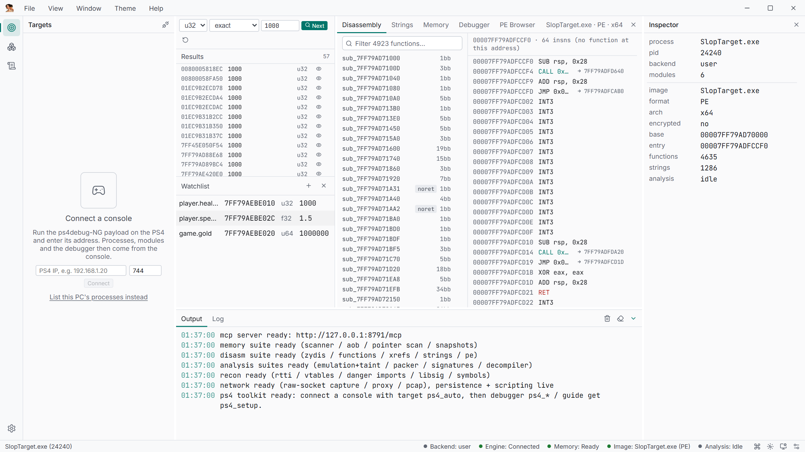
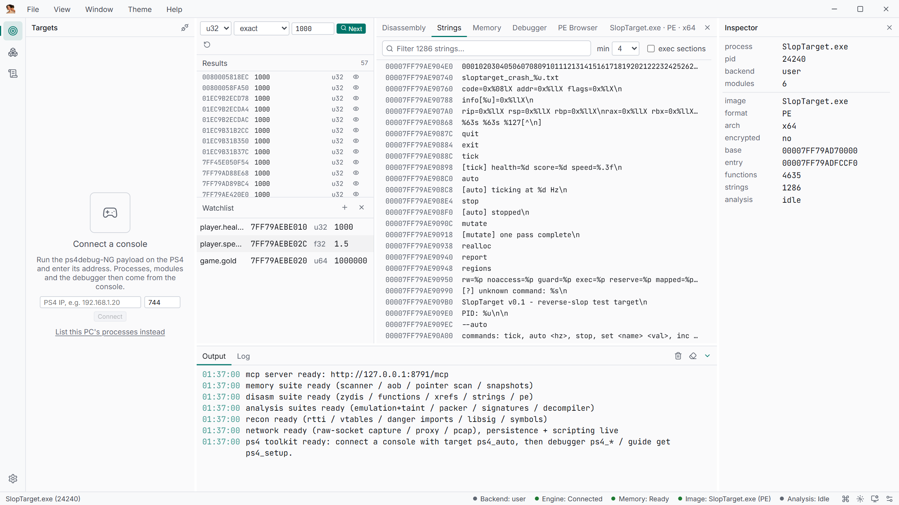
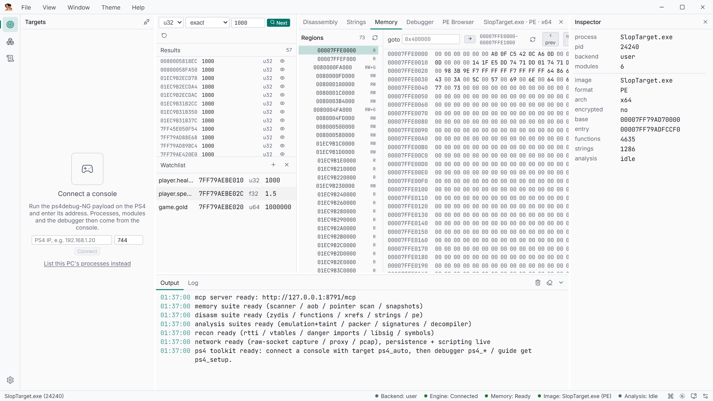
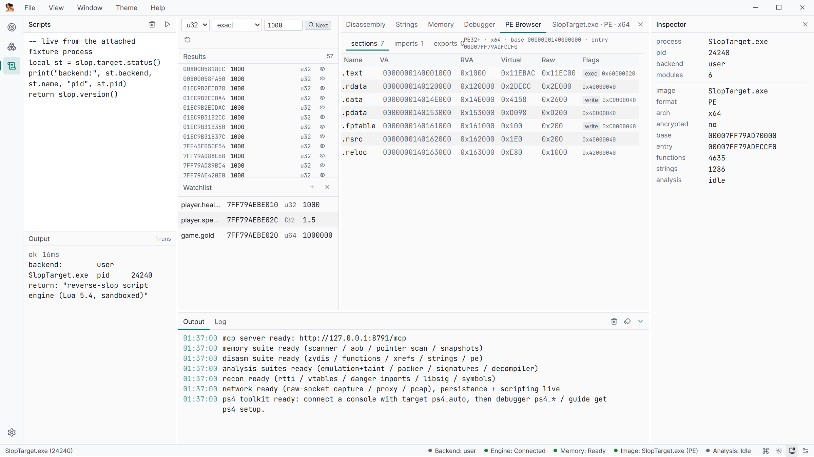
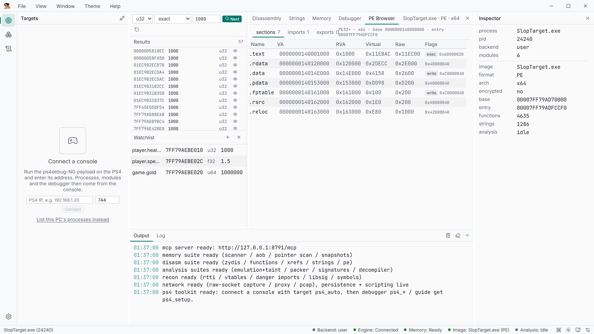
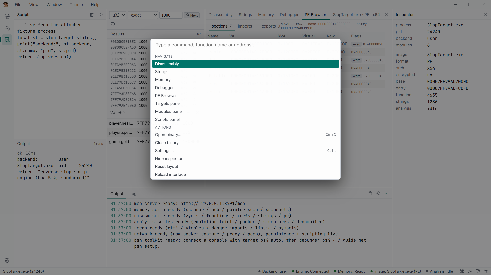
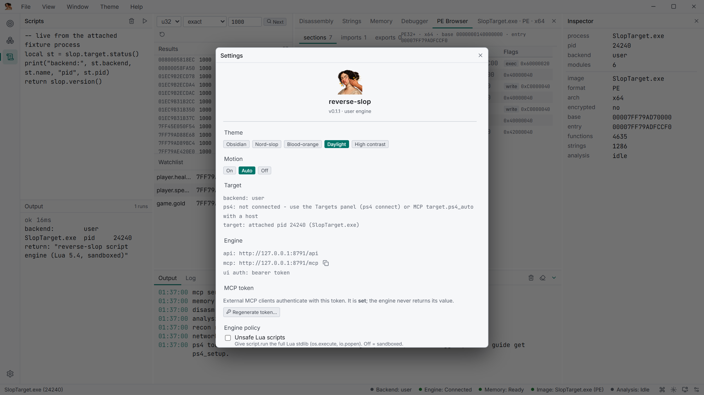
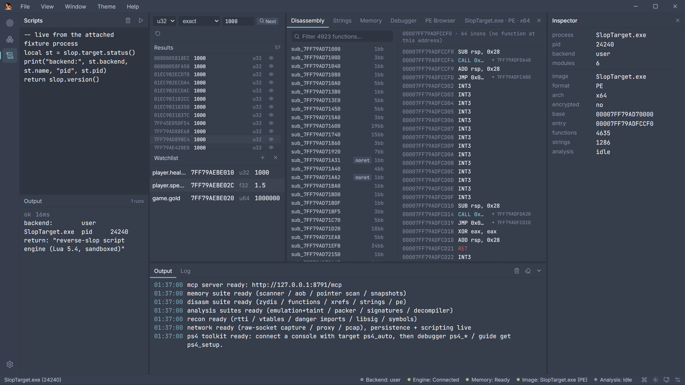
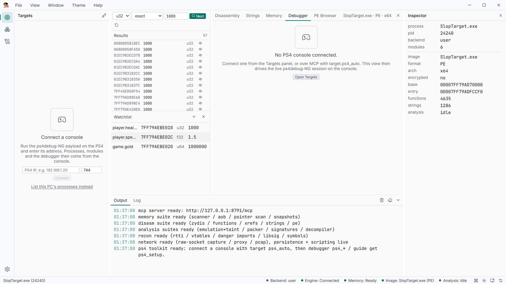
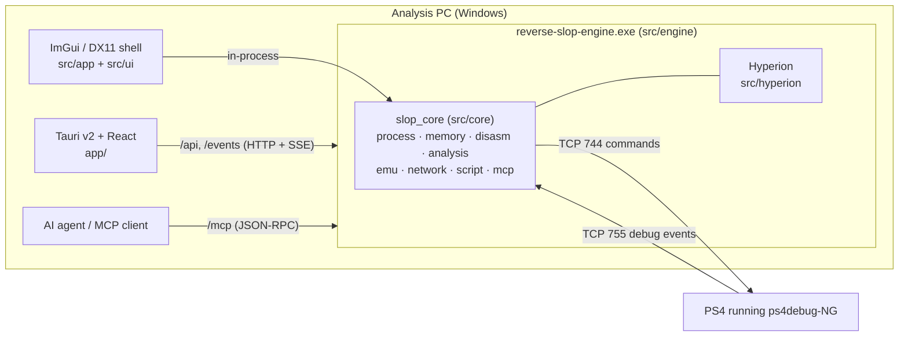

<p align="center">
  
</p>

<h1 align="center">reverse-slop</h1>

<p align="center">
  <b>PS4 reverse-engineering workbench</b><br/>
  live memory, scanning and debugging over ps4debug-NG · static analysis of dumped modules ·
  Lua scripting · a built-in MCP server so AI agents can drive the whole workflow
</p>

<p align="center">
  <a href="https://github.com/NetVar1337/PS4-Slop/actions/workflows/build.yml"></a>
  
  
  
  
</p>

> [!WARNING]
> Use reverse-slop only on consoles, games, and systems you own or are authorized to test.
> Live debugging and memory writes can crash the console or the game. Host-side packet
> capture needs administrator rights on the analysis PC.



<sub>Screenshots on this page were captured from the real UI against the bundled
[`SlopTarget`](src/target) fixture over the local user-mode backend — every address and
value is genuine runtime data. Views that require a console (Debugger, on-console
scanning) are shown in their waiting state; connect a PS4 and they come alive.</sub>

---

## What it does

| Area                   | Summary                                                                                                                                                                                                                                    |
| ---------------------- | ------------------------------------------------------------------------------------------------------------------------------------------------------------------------------------------------------------------------------------------ |
| **Console connection** | Speaks the [ps4debug-NG](https://github.com/NetVar1337/ps4debug-NG) wire protocol directly (TCP 744 + the port-755 event callback; upstream Pharaoh2k builds work too). Nothing is installed on the PC side of the wire.                   |
| **Live memory**        | Process list, attach, regions, modules, threads, read/write/protect/alloc, Cheat Engine-style scans, AOB search, pointer chains, snapshots and diffs, a shared watchlist with freeze.                                                      |
| **Live debugging**     | Software breakpoints, DR0–DR3 hardware watchpoints, continue/step/suspend, stop events with full register sets, callstacks, FP/FS-GS registers, remote function calls, one-call trace actions.                                             |
| **On-console tooling** | Native scan/rescan, **Turbo Scan** (server-resident SIMD/aliasing scans + snapshots), verified bulk writes (`ps4_write_multi`), fork `ps4_modules` / `ps4_snapshot`, Zydis disassembly, xrefs, stack walks, Keystone assembly, ELF upload. |
| **Static analysis**    | ELF64 (SCE imports with **NID→name resolution**, relocations), decrypted-SELF extraction, PE and Mach-O/`.ipa`; function, xref and string indexes; Xray passes; patching with a journal; binary diffing; packer heuristics.                |
| **Decompiler**         | Hyperion p-code lifting, SSA, DCE, type inference and structuring to C-like output (SysV AMD64, Win64, AAPCS64).                                                                                                                           |
| **Emulation**          | Isolated Unicorn x86-64 runs with demand paging from the loaded image or live memory, tracing and byte-level taint.                                                                                                                        |
| **Automation**         | Lua 5.4 against the same shared session as the UI, plus an MCP server with 22 action-based tools, task playbooks (`guide`), a JSONL audit log and an optional `confirm` gate on mutating actions (`mcp_require_confirm`).              |
| **Payload host**       | Built-in HTTP payload host (`host` tool): serves your own payloads with an auto-generated sha256 `manifest.json`; LAN binds require a token. UDP broadcast console discovery (`target.ps4_discover`, `host:"auto"`). See [`docs/MERGE.md`](docs/MERGE.md). |
| **Host network**       | Raw-socket capture, DNS log, stream reassembly, PCAP export, and a localhost HTTP inspection proxy.                                                                                                                                        |

Two desktop shells drive the same C++ core: the **Tauri v2 + React** app (the one that
ships) and a legacy **ImGui/DX11** shell. The engine also runs headless for MCP/HTTP
clients only — and the same core attaches to local Windows processes for console-free
development and testing.

## Screenshots

**Workspace** — scanner results (62 hits for `1000`), a live watchlist, disassembly and inspector on the bundled fixture.

<table>
<tr>
<td width="50%"><br><b>Disassembly</b> — virtualized function list (4,923 functions) with flow-coloured instruction listing and jump following.</td>
<td width="50%"><br><b>Strings</b> — string index with min-length / exec-section filters; click to follow xrefs.</td>
</tr>
<tr>
<td width="50%"><br><b>Memory</b> — region list and a 4 KiB-paged hex editor on the attached process, editable in place.</td>
<td width="50%"><br><b>Lua scripts</b> — scratchpad (`Ctrl+Enter`) against the same session as the UI and MCP.</td>
</tr>
<tr>
<td width="50%"><br><b>PE browser</b> — sections, imports, exports of the loaded image (Mach-O for iOS images).</td>
<td width="50%"><br><b>Command palette</b> — `Ctrl+K` jumps to functions, addresses, tabs and actions.</td>
</tr>
<tr>
<td width="50%"><br><b>Settings</b> — theme, motion, engine endpoints, MCP token policy, Lua sandbox toggle.</td>
<td width="50%"><br><b>Themes</b> — Nord-slop shown; also Obsidian (default), Blood-orange, Daylight, High-contrast.</td>
</tr>
<tr>
<td width="50%"><br><b>Debugger</b> — waiting for a console; once connected: registers, callstack, breakpoints, watchpoints, event feed.</td>
</tr>
</table>

## Quick start

**1. Prerequisites**

| Needed for  | Requirement                                                                                                |
| ----------- | ---------------------------------------------------------------------------------------------------------- |
| Everything  | Windows 10/11 x64, PowerShell, Git, internet access on first configure                                     |
| C++ engine  | Visual Studio 2022+ with _Desktop development with C++_ (x64 tools), CMake ≥ 3.25, Ninja (VS bundles both) |
| Desktop app | Node.js + npm, Rust/Cargo, WebView2 runtime (bundled with Windows 11)                                      |
| Console     | A PS4 on the same network running the ps4debug-NG payload                                                  |
| Optional    | Administrator rights (host packet capture), Magicmida sidecars (Themida unpacking)                         |

**2. Build**

```powershell
git clone https://github.com/NetVar1337/PS4-Slop.git
cd PS4-Slop
powershell -File tools/build.ps1          # C++ engine + Tauri app (portable folder + installer)
powershell -File tools/build.ps1 -NoFrontend   # C++ only, fastest loop
```

**3. Run**

```powershell
.\dist\reverse-slop\reverse-slop.exe      # desktop app (spawns the engine as a sidecar)
```

**4. Connect the console**

Load ps4debug-NG on the PS4, then in the **Targets** panel press the gamepad button, enter
the console IP and connect. Or let an agent do it in one call:

```json
{ "tool": "target", "action": "ps4_auto", "params": { "host": "192.168.1.50" } }
```

`ps4_auto` connects, authenticates the native scanner, picks the game process (the one
with `/app0/` modules, eboot-named preferred), attaches a session and the debug session,
and returns modules, threads and regions. No console handy? Click **“List this PC’s
processes instead”** in Targets and attach to any local process — everything except the
`ps4_*` actions works.

## Typical workflows

**Find and freeze a value**

1. Targets → connect → attach the game.
2. Scanner: choose a width (`u32`, `f32`, …), type the current value, **First**.
3. Change the value in game, type the new one, **Next** until a handful remain.
4. Add the hit to the watchlist and toggle **freeze**; the watch service writes it back about 10× per second.

**Find what writes an address**

```json
{
  "tool": "debugger",
  "action": "ps4_find_write",
  "params": { "addr": "0x200001000", "len": 4, "timeout_ms": 10000 }
}
```

Arms a write watchpoint, resumes, waits for the hit and returns the event with the
writer's callstack. `ps4_until`, `ps4_trace_calls` and `ps4_trace_steps` cover the other
common one-shot moves.

**Dump a module and analyze it offline**

```json
{
  "tool": "target",
  "action": "ps4_dump_module",
  "params": { "name": "eboot.bin", "path": "C:/dumps/eboot.bin", "load": true }
}
```

`load: true` opens an ELF dump in the Disassembly workspace (functions, xrefs, strings,
Xray, patching). The Debugger view has the same **dump+load** action.

**Let an agent drive**

Start the app (or `reverse-slop-engine.exe`) and point an MCP client at
`http://127.0.0.1:8765/mcp`. Supported clients are registered automatically on first
start (see [Automatic MCP client registration](#automatic-mcp-client-registration)).
`guide list` / `guide get {topic}` return ready-to-run tool sequences such as
`ps4_setup`, `ps4_breakpoint`, `ps4_find_write`, `ps4_native_scan`, `find_health`,
`pointer_chain` and `ps4_dump_and_analyze`.

**If the payload or the game restarts**

Console commands start failing after the drop; `target.ps4_reconnect` re-runs the
handshake and authentication, re-attaches the debug session and re-arms the breakpoints
and watchpoints you had set.

Scriptable versions of these flows live in [`examples/`](examples) (PS4 Lua scripts plus
the older UE5 dumper example).

## Desktop UI

Left to right: the activity rail (Targets, Modules, Scripts, Settings), the selected side
panel, the scanner and watchlist, the tabbed workspace above the Output/Log pane, and the
Inspector. The status bar shows backend, engine, memory, image and analysis state.

| Panel               | What it does                                                                                                                |
| ------------------- | --------------------------------------------------------------------------------------------------------------------------- |
| Targets             | Console connect bar (host/port) and auto setup, or this PC's process list with filter and attach/detach.                    |
| Modules             | Module list of the attached process with **Dump** and **Dump + analyze**.                                                   |
| Scripts             | Lua scratchpad (`Ctrl+Enter` runs) with per-run output history.                                                             |
| Scanner / Watchlist | Value scanner (width, compare, value; first/next) and the shared watchlist with freeze/poke/remove.                         |
| Disassembly         | Virtualized function list with filter and rename, instruction listing with flow colouring and jump-following.               |
| Strings             | String hits of the loaded image with min-length and exec-section filters; follows xrefs.                                    |
| Memory              | Region list plus a 4 KiB-paged hex editor with goto and in-place byte edits.                                                |
| Debugger            | PS4 run control, registers, callstack, breakpoints, watchpoints, event feed, on-console scan/AOB, notifications, dump+load. |
| PE Browser          | Sections, imports and exports of the loaded image (Mach-O browser for iOS images).                                          |
| Output / Log        | Engine output (SSE, replayed on reconnect) and the diagnostic log.                                                          |
| Inspector           | Facts about the attached target, the loaded image and analysis state.                                                       |
| Settings            | Theme, motion, target status, engine endpoints, MCP token (show/regenerate), Lua sandbox and web egress toggles.            |

Shortcuts: `Ctrl+O` open binary · `Ctrl+G` go to address · `Ctrl+1…5` workspace tabs ·
`Ctrl+,` settings · `Ctrl+K` command palette · `Ctrl+Alt+I` inspector. Themes, motion,
panel sizes, the active rail and workspace tab persist.

### Legacy ImGui shell

`build\src\app\reverse-slop.exe` (requests elevation) is the original native shell, kept
for parity work. It has the same core views with `Ctrl+1`…`Ctrl+0` shortcuts (Targets,
Inspector, Disassembly, Memory, Output, Scanner, Strings, PE Browser, Debugger,
Pseudocode), an Unpacker view and `F12` frame metrics.

## Feature reference

### Console connection (ps4debug-NG)

- `target.ps4_connect {host, port=744, pid?}`, `target.ps4_disconnect`, `target.ps4_auto {host, port?}`.
- Once connected, `target.list` enumerates console processes and `target.attach {pid}`
  opens a session over the wire; the backend badge reads `PS4`.
- Reads are validated against the console VM map, so unmapped ranges fail instead of
  returning zeros. Windows `PAGE_*` constants are translated to FreeBSD `VM_PROT_*`.
- `target.ps4_dump_module {name|base, path, load?}` pulls a module's memory image off the console.

### Live memory

- Read/write in hex, UTF-8, integer and float formats; allocate, free, change protection.
- Initial and refined numeric scans: exact/range/changed/unchanged, signed/unsigned/float
  widths, rounding, region/protection/alignment filters, worker/chunk/result caps.
- AOB wildcard search, pointer-chain scans, signature generation, live crypto-constant search.
- Memory snapshots with compare/list/free.
- Shared watchlist sampled about 10 Hz with freeze writes; UI and MCP edits appear in both.
- Pointer-chain scans can be re-verified over multiple samples (`pointerscan_verify`).

### Live debugging

Every action below lives on the `debugger` tool.

| Group         | Actions                                                                                                                                    |
| ------------- | ------------------------------------------------------------------------------------------------------------------------------------------ |
| Session       | `ps4_attach {pid}`, `ps4_detach`, `ps4_status`                                                                                             |
| Breakpoints   | `ps4_bp_set {addr, index?}`, `ps4_bp_clear {addr\|index}`, `ps4_bp_list` (slots 0-29, allocated client-side)                               |
| Watchpoints   | `ps4_watch_set {addr, len=1\|2\|4\|8, type=0 exec\|1 write\|3 rw, index?}`, `ps4_watch_clear`, `ps4_watch_list` (DR0-DR3)                  |
| Run control   | `ps4_continue {stop: 0 resume\|1 SIGSTOP\|2 SIGKILL}`, `ps4_step {lwpid?}`, `ps4_suspend`/`ps4_resume {lwpid}`, `ps4_process_stop {state}` |
| Events        | `ps4_wait {timeout_ms}` (next stop: registers, signal, thread name, DRs), `ps4_events {max, clear}`                                        |
| Registers     | `ps4_regs`, `ps4_set_reg {lwpid, name, value}`, `ps4_dbregs`, `ps4_set_dbregs`, `ps4_fpregs`, `ps4_set_fpregs`, `ps4_fsgs`, `ps4_set_fsgs` |
| Stack         | `ps4_callstack {lwpid, depth}` (rbp chain over live reads), `ps4_stack` (server-side walk with locals and code windows)                    |
| Remote calls  | `ps4_call {addr, args[6]}` — installs the payload RPC stub once per process and returns `rax`                                              |
| Power actions | `ps4_until`, `ps4_find_write`, `ps4_trace_calls`, `ps4_trace_steps`                                                                        |

### On-console tooling (runs inside the payload)

- **Turbo Scan & bulk writes** ([NetVar1337/ps4debug-NG](https://github.com/NetVar1337/ps4debug-NG)):
  `ps4_turbo_caps`, `ps4_turbo_regions`, `ps4_turbo_config`, `ps4_turbo_scan`,
  `ps4_turbo_rescan`, `ps4_turbo_results`, `ps4_turbo_cancel`, `ps4_turbo_end`, and
  `ps4_write_multi` (up to 65,535 verified writes in one round-trip).
- **Fork extensions**: `ps4_modules` (server-side module list) and `ps4_snapshot`
  (one-round-trip region stream of any size); `target.modules` uses `CMD_PROC_MODULES`
  automatically with a client-side map-grouping fallback on upstream payloads.
- **Native scan** (unlocked by `ps4_auth`): `ps4_scan`, `ps4_rescan` (exact/fuzzy/compare
  modes), `ps4_scan_state`, `ps4_scan_reset`, `ps4_scan_all`, `ps4_scan_aob` (`??` wildcards).
- **Code analysis**: `ps4_disasm {addr, len}`, `ps4_xrefs {addr, len}`, `ps4_xrefs_to {addr, len, target}`.
- **Assembly**: `ps4_assemble {asm, base?, syntax?}` (payload-side Keystone); write the bytes with `memory.write`.
- **ELF upload**: `ps4_elf_rpc {path}` (returns the entry) and `ps4_elf_load {path}`.
- **Console**: `ps4_notify {msg, type?}`, `ps4_print {msg}`, `ps4_app` (foreground pid, title ID, content ID, version).

### Static analysis

- ELF64 with **NID→name resolution** (built-in database, overridable via
  `%LOCALAPPDATA%\reverse-slop\nids.txt`) and relocation application; SELF header/segment
  extraction for plaintext images; PE headers/imports/exports; Mach-O thin/FAT and `.ipa`.
- Fast Zydis function, xref and string indexes; Capstone for ARM64.
- Background Hyperion analysis (CFGs, globals, vtables, RTTI, names) and the decompiler
  for PE and Mach-O images; .NET assemblies list types, render C#, or dump IL.
- **Xray** (read-only): CFG and cyclomatic complexity, control-flow flattening and
  obfuscation scoring, string reconstruction, indirect-call recovery, anti-analysis
  patterns, hook checks, direct syscalls, API-hash resolution, entropy windows, page
  classification, crypto constants, ROP gadgets.
- **Patching** (loaded image only): junk-NOP cleanup, opaque predicates, anti-debug, XOR
  unpack, string decoding, explicit byte writes, a patch journal with full revert, a
  combined pass, and re-indexing after edits.
- Binary-to-binary function diff, packer/protector indicators, RTTI/vtable recovery,
  dangerous-import callsites, library signatures, user structs/enums, comments and bookmarks.
- Names, comments and bookmarks persist per file hash and remap across runtime bases.

### Emulation and devirtualization

- Unicorn x86-64 runs from bytes, loaded-image addresses or live target addresses, with
  demand paging, IAT stubs that log calls, custom registers/stack/memory, stop
  conditions, bounded traces and byte-granular taint.
- VM identification, handler discovery, opcode maps, trace/lift/pseudocode, CFG recovery,
  predicate proofs, invariants and IAT audits.
- Supervised Magicmida (Themida) jobs with architecture checks, cancellation and timeouts.

### Host network and proxy

- Raw-socket capture on the analysis PC (SIO_RCVALL, administrator): packet paging with
  text filters, DNS log, statistics, stream listing and reassembly, per-packet
  HTTP/TLS/DNS inspection, PCAP export.
- Independent localhost HTTP/1.1 proxy: start/stop, captured exchanges, replay. CONNECT
  tunnels record metadata and SNI only; TLS interception (`mitm_enable`) requires explicit
  consent, installs a local CA, and is fully reversible (`mitm_uninstall`).

### Persistence, filesystem and web

- SQLite session snapshots and key/value storage; Hyperion `.hdb` export/import.
- Host filesystem read/write/list/create/delete/search/grep.
- Outbound WinHTTP GET/POST without browser-cookie inheritance; private/loopback targets
  are denied unless explicitly allowed.

## Lua scripting

Scripts run from the **Scripts** panel, the `script` MCP tool (`action=run`, `code`,
`timeout_ms`) or `/api`, against the same session as the UI — renames and comments made
in one surface show up in all of them. Returned values are appended as `return: <value>`.
Scripts are sandboxed by default (no `io`/`os` execution, memory and instruction caps);
set `script_unsafe` in Settings for the full standard library.

```lua
-- read the player struct on the console, then rank the dump's functions
local st = slop.target.status()
print("backend:", st.backend, st.name, st.pid)
local raw = slop.mem.read_bytes(0x200001000, 12)         -- raw bytes
local hp, ammo, lives = string.unpack("<i4i4i4", raw)
print("player: hp=" .. hp .. " ammo=" .. ammo .. " lives=" .. lives)

-- the debugger surface is scriptable too
slop.ps4.attach(st.pid)
slop.ps4.bp_set(0x484490)
local ev = slop.ps4.wait(5000)
print(("stop: rip=0x%X thread=%s"):format(ev.rip, ev.thread))

local fns = slop.disasm.functions(4000)
table.sort(fns, function(a, b) return a.size > b.size end)
for i = 1, 5 do
  print(string.format("%X  %s  %d bytes", fns[i].va, fns[i].name, fns[i].size))
end
```

| Group             | Functions                                                                                           |
| ----------------- | --------------------------------------------------------------------------------------------------- |
| Core              | `slop.version()`, `slop.log(msg)`                                                                   |
| Target            | `slop.target.list()`, `attach(pid)`, `status()`                                                     |
| Memory            | `slop.mem.read_hex(addr, len)`, `write_hex(addr, data)`, `scan(...)`                                |
| Image session     | `slop.image.load(path[, base])`, `load_from_target`, `unload`, `status`, `wait_ready([ms])`         |
| Instructions      | `slop.disasm.decode(addr[, count])`, `bytes(addr[, len])`, `disassemble(...)` (live memory)         |
| Functions / xrefs | `slop.disasm.functions([limit])`, `function_at(va)`, `xrefs_to(va)`                                 |
| Data              | `slop.disasm.strings([min[, limit]])`, `slop.disasm.pe()`                                           |
| Annotation        | `slop.disasm.name/set_name/comment/set_comment`, `bookmark_toggle`, `bookmarks`                     |
| Decompiler        | `slop.decomp.decompile(va)`, `blocks(va)`, `vtables()`, `globals()`, `rtti()` (need `wait_ready()`) |
| Analysis          | `slop.analyze.packer()`                                                                             |

## MCP and HTTP API

### Endpoints

The listener binds `127.0.0.1` only.

| Endpoint      | Purpose                                                                                                                                                  |
| ------------- | -------------------------------------------------------------------------------------------------------------------------------------------------------- |
| `GET /health` | Liveness and version                                                                                                                                     |
| `POST /mcp`   | MCP JSON-RPC 2.0: `initialize`, `ping`, `tools/list`, `tools/call` (protocol `2025-06-18`)                                                               |
| `GET /mcp`    | MCP SSE endpoint / keepalive                                                                                                                             |
| `POST /api`   | Direct frontend RPC; one request or an array                                                                                                             |
| `GET /events` | Frontend SSE stream: `hello`, `output`, `boot.stage`, `target.changed`, `backend.changed`, `hype.progress`, `watch.list`, `watch.values`, `app.quitting` |

`initialize` also returns `instructions` (a usage preamble) and `state` (backend badge,
attached target, debugger state, loaded image, analysis readiness). The same context is
available later through `target.status` and `disasm.loaded`.

```powershell
Invoke-RestMethod http://127.0.0.1:8765/health

$body = @{ tool = 'target'; action = 'ps4_auto'; params = @{ host = '192.168.1.50' } } | ConvertTo-Json
Invoke-RestMethod -Method Post -Uri http://127.0.0.1:8765/api -ContentType 'application/json' -Body $body

$body = @{ jsonrpc = '2.0'; id = 1; method = 'tools/call'
           params = @{ name = 'target'; arguments = @{ action = 'list' } } } | ConvertTo-Json -Depth 8
Invoke-RestMethod -Method Post -Uri http://127.0.0.1:8765/mcp -ContentType 'application/json' -Body $body
```

### Configuration and security

`%LOCALAPPDATA%\reverse-slop\settings.json`:

```json
{
  "mcp_enabled": true,
  "mcp_port": 8765,
  "mcp_token": "<auto>",
  "mcp_onboarded": false
}
```

- **A bearer token is generated automatically on first start**; every `/mcp` and `/api`
  call needs `Authorization: Bearer <token>`. Regenerate it from Settings
  (`app.rotate_token`) — client configs and `engine.json` are updated in place.
  `SLOP_MCP_TOKEN` adds a per-process token without persisting anything.
- `SLOP_MCP_PORT` or `--port` overrides the port. If the port is busy the engine takes an
  ephemeral port and skips onboarding.
- The event stream (`/events`) authenticates with a **single-use ticket** from
  `app.events_ticket` — no token in URLs.
- Other settings: `script_unsafe` (full Lua `io`/`os`), `web_allow_private` /
  `web_allowlist` (deny loopback/LAN by default), `proxy_token`.
- Request bodies are capped at 32 MiB. Every route validates `Host` and browser `Origin`
  (DNS-rebinding and cross-site JSON-RPC get 403).
- Treat `script.run` as code execution regardless of the sandbox — the `slop.*` surface
  writes memory and files.

### Tool index

Every tool takes an `action`; `tools/list` returns the exact schemas.

| Tool       | Actions                                                                                                                                                                                                                                                                                 |
| ---------- | --------------------------------------------------------------------------------------------------------------------------------------------------------------------------------------------------------------------------------------------------------------------------------------- |
| `target`   | `list`, `attach`, `detach`, `status`, `modules`, `dump_module`, `threads`, `regions`, `handles`, `heaps`, `heap_blocks`, `icon`, `ps4_connect`, `ps4_disconnect`, `ps4_reconnect`, `ps4_auto`, `ps4_dump_module`                                                                        |
| `memory`   | `read`, `write`, `scan`, `rescan`, `scan_state`, `scan_reset`, `aob`, `pointerscan`, `snapshot`, `snapshots`, `diff`, `snapshot_free`, `protect`, `alloc`, `free`, `siggen`, `live_crypto`, `watch_list`, `watch_add`, `watch_remove`, `watch_clear`, `watch_set`, `pointerscan_verify` |
| `debugger` | `status` plus all `ps4_*` actions above                                                                                                                                                                                                                                                 |
| `disasm`   | `assemble`, `disassemble`, `loaded`, `pe`, `functions`, `xrefs`, `strings`, `symbols`, `symbol_set`, `blocks`, `globals`, `vtables`, `load`, `unload`, `analyze_stop`, `managed`                                                                                                        |
| `decomp`   | `function`                                                                                                                                                                                                                                                                              |
| `xray`     | `cfg`, `complexity`, `cff`, `obfuscation`, `strings_recon`, `indirect_calls`, `anti_analysis`, `hooks`, `syscalls`, `apihash`, `entropy`, `pages`, `crypto_range`, `gadgets`                                                                                                            |
| `patch`    | `nop_junk`, `resolve_opaque`, `patch_antidebug`, `unpack_xor`, `decode_strings`, `write_bytes`, `revert_all`, `journal`, `full_pass`, `rebuild`                                                                                                                                         |
| `devirt`   | `themida_status`, `themida_start`, `themida_job`, `themida_cancel`, `identify`, `handlers`, `opcode_map`, `trace`, `lift`, `pseudocode`, `recover_cfg`, `prove_predicates`, `invariants`, `iat_audit`                                                                                   |
| `emulate`  | `run`                                                                                                                                                                                                                                                                                   |
| `analyze`  | `packer`, `signatures`, `diff`                                                                                                                                                                                                                                                          |
| `re`       | `rtti_scan`, `vftable`, `danger`, `libsig`                                                                                                                                                                                                                                              |
| `types`    | `declare`, `create_struct`, `get_struct`, `list_structs`, `add_member`, `remove_member`, `create_enum`, `get_enum`, `list_enums`, `remove_enum`, `read_field`, `format_at`                                                                                                              |
| `notes`    | `set_comment`, `get_comment`, `comments`, `bookmark_toggle`, `bookmarks`                                                                                                                                                                                                                |
| `network`  | `status`, `capture_start`, `capture_stop`, `packets`, `dns`, `stats`, `export_pcap`, `streams`, `stream_data`, `reassemble_stream`, `connections`, `deep_inspect`                                                                                                                       |
| `proxy`    | `start`, `stop`, `status`, `entries`, `entry`, `replay`, `mitm_enable`, `mitm_disable`                                                                                                                                                                                                  |
| `persist`  | `save`, `list`, `load`, `delete`, `kv_set`, `kv_get`, `hype_save`, `hype_load`                                                                                                                                                                                                          |
| `fs`       | `read_file`, `write_file`, `list_directory`, `create_directory`, `delete_path`, `search_files`, `grep_in_files`                                                                                                                                                                         |
| `web`      | `fetch`, `post`                                                                                                                                                                                                                                                                         |
| `script`   | `run`                                                                                                                                                                                                                                                                                   |
| `gdb`      | `start` (loopback-only, `allow_writes` opt-in for RSP memory/register writes), `stop`, `status` (broker clients + console state) - GDB Remote bridge sharing the console debug session with the UI and MCP |
| `host`     | `start`, `stop`, `status`, `put` - HTTP payload host with sha256 `manifest.json`, token on non-loopback binds |
| `guide`    | `list`, `get`                                                                                                                                                                                                                                                                           |

`app` (`status`, `ping`, `output`, `output_clear`, `log`, `diag`, `shutdown`) is frontend
plumbing, reachable through `/api` only and hidden from `tools/list`.

### Automatic MCP client registration

On the first successful start on the configured port, a `reverse-slop` HTTP entry is added
(existing entries are kept) to:

| Client      | File                                                        |
| ----------- | ----------------------------------------------------------- |
| Claude Code | `%USERPROFILE%\.claude.json` (user scope, `"type": "http"`) |
| Cursor      | `%USERPROFILE%\.cursor\mcp.json`                            |
| Windsurf    | `%USERPROFILE%\.codeium\windsurf\mcp_config.json`           |
| VS Code     | `%APPDATA%\Code\User\settings.json` (`mcp.servers`)         |
| OpenCode    | `%USERPROFILE%\.config\opencode\config.json`                |

Claude Desktop only supports stdio servers in its config file; add the URL through its
Connectors UI. Unparseable config files are left untouched. When a token is set, it is
written into these files — **do not sync them publicly**. Run the engine with
`--no-onboard` to skip registration; set `mcp_onboarded` to `false` to request another pass.

## Architecture



- The Tauri supervisor (`app/src-tauri`) starts the engine as a sidecar, waits for the
  `SLOP_ENGINE_READY <port> <token>` handshake (up to 180 s, covering the UAC prompt),
  holds it in a kill-on-close job object and lets it shut down cleanly. Keeping the
  engine out of the Rust process avoids CRT mixing and isolates crashes.
- Both hosts share the lifecycle in `src/core/infra/lifecycle.cpp`: paths and worker
  queues → process/target services → settings and persistence → MCP/API server and
  onboarding → periodic target/watch/event servicing → orderly shutdown.
- Without a console, the active backend is the Win32 user-mode backend (`OpenProcess` /
  `ReadProcessMemory`) — the same one the test fixture drives.

```text
src/
├── app/       Win32 entry + DX11 loop (legacy shell)
├── engine/    headless host and parent-process contract
├── ui/        ImGui chrome, docking, theme, views
├── hyperion/  vendored analysis/decompiler engine (hype namespace)
├── core/
│   ├── infra/     lifecycle, jobs, settings, paths, events, onboarding
│   ├── runtime/   ps4debug-NG backend + Win32 user-mode backend
│   ├── process/   targets, processes, modules, threads, dumps
│   ├── memory/    scanner, AOB, pointer scan, snapshots, watch service
│   ├── debugger/  call-stack unwinding
│   ├── disasm/    image loading, Zydis/Capstone indexes, Hyperion bridge
│   ├── analysis/  packer, signatures, xray, patches, devirt, Magicmida
│   ├── emu/       Unicorn execution and taint
│   ├── network/   raw capture, traffic store, proxy, WinHTTP
│   ├── script/    Lua engine
│   ├── mcp/       MCP schemas, tool dispatcher, /api, /events
│   └── persist, re, util
├── target/    deterministic live-analysis fixture (SlopTarget.exe)
├── tests/     core test harness (slop_tests.exe)
└── live/      live probes
app/           Tauri v2 supervisor and React/TypeScript frontend (e2e/ = e2e driver)
tools/         build, Magicmida installer, live-test, benchmark and screenshot scripts
examples/      Lua scripts (PS4 breakpoints, eboot overview, find-value)
```

## Building

`tools/build.ps1` finds Visual Studio with `vswhere`, uses its bundled CMake and Ninja,
configures the `ninja-msvc-release` preset into `build/`, then builds the Tauri app.
First configure downloads pinned dependencies into `_ext/` (ImGui, FreeType, Zydis,
Capstone, Unicorn, nlohmann/json, cpp-httplib, SQLite, Lua, fmt, spdlog, zlib).

| Switch           | Effect                                                                                                 |
| ---------------- | ------------------------------------------------------------------------------------------------------ |
| _(none)_         | C++ engine + Tauri portable folder (`dist\reverse-slop\`) + NSIS installer                             |
| `-NoFrontend`    | C++ targets only                                                                                       |
| `-FullClean`     | Delete `build/` before configuring                                                                     |
| `-PlanOnly`      | Configure without compiling                                                                            |
| `-Preset <name>` | `ninja-msvc-debug`, `ninja-msvc-asan` (AddressSanitizer), `ninja-msvc-analyze` (`/analyze`)            |
| `-Full`          | Self-contained installer: embeds WebView2 and Magicmida, fails instead of skipping a missing component |

First-party targets compile with `/W4 /WX`. The legacy ImGui shell is optional
(`SLOP_BUILD_UI`), and CI keeps it compiling.

| CMake option             | Default | Builds                   |
| ------------------------ | ------: | ------------------------ |
| `SLOP_BUILD_ENGINE`      |    `ON` | headless engine          |
| `SLOP_BUILD_UI`          |    `ON` | legacy ImGui shell       |
| `SLOP_BUILD_TEST_TARGET` |    `ON` | `SlopTarget.exe` fixture |
| `SLOP_BUILD_TESTS`       |    `ON` | `slop_tests.exe`         |

Manual configure (from an x64 developer shell):

```powershell
cmake --preset ninja-msvc-release -S .
cmake --build --preset ninja-msvc-release
```

Outputs:

```text
build\src\engine\reverse-slop-engine.exe                     headless engine
build\src\app\reverse-slop.exe                               legacy ImGui shell
dist\reverse-slop\reverse-slop.exe                           portable Tauri app (carries engine\)
app\src-tauri\target\release\bundle\nsis\...-setup.exe       per-machine installer
```

Release Tauri builds request elevation so the engine can capture packets; debug builds run
as the invoking user and report capture as unavailable.

### Frontend development

```powershell
powershell -File tools/build.ps1 -NoFrontend   # build or refresh the engine first
cd app
npm install
npm run tauri -- dev        # Vite on fixed port 1420 (the engine's CORS allow-list expects it)
npm run typecheck
npm run build
npm test                    # store-level smoke tests
npm run check:api -- 8765   # validate frontend calls against a running engine's tools/list
```

### Headless engine

```powershell
.\build\src\engine\reverse-slop-engine.exe --no-onboard
```

| Option               | Effect                                         |
| -------------------- | ---------------------------------------------- |
| `--no-onboard`       | Do not register the MCP endpoint in AI clients |
| `--quiet`            | Do not mirror engine output to stderr          |
| `--port <n>`         | Override the MCP/API port                      |
| `--parent-pid <pid>` | Exit cleanly when the parent exits             |

Startup prints `SLOP_ENGINE_READY <port> <token>`. If another live engine is advertised,
the new one prints `SLOP_ENGINE_EXISTING <pid>` and exits.

### Magicmida (optional)

Magicmida and ScyllaHide are separate GPLv3 programs, never linked into reverse-slop.

```powershell
powershell -File tools/install_magicmida.ps1   # pinned release, SHA-256 verified
```

Installs to `%LOCALAPPDATA%\reverse-slop\tools\magicmida\<version>\{x86,x64}`. Override with
`SLOP_MAGICMIDA_ROOT`, `SLOP_MAGICMIDA_X86` or `SLOP_MAGICMIDA_X64`.

## Runtime data

Everything lives under `%LOCALAPPDATA%\reverse-slop`:

| Path                    | Purpose                                                             |
| ----------------------- | ------------------------------------------------------------------- |
| `settings.json`         | MCP and runtime settings                                            |
| `engine.json`           | live engine PID/port/token; removed on clean exit — do not share it |
| `dock.ini`              | ImGui layout                                                        |
| `sessions.db`           | SQLite snapshots and key/value state                                |
| `symbols\<hash>.json`   | per-binary names, comments, bookmarks                               |
| `sessions\`, `crashes\` | session and crash artifacts                                         |
| `tools\magicmida\…`     | optional Magicmida install                                          |

## Tests

```powershell
.\build\tests\slop_tests.exe                       # full suite
ctest --test-dir build --output-on-failure         # registered CTest subsets
$env:SLOP_TEST_FILTER = 'ps4'; .\build\tests\slop_tests.exe; Remove-Item Env:SLOP_TEST_FILTER
```

The PS4 tests run the backend and the `ps4_*` MCP flows against a fake ps4debug-NG server
on loopback, including chaos modes (fragmented replies, mid-transfer disconnects) and the
reconnect/slot-restore flows. Other suites cover infrastructure, memory, disassembly, MCP
wire/schemas, analysis, emulation, the capture store, persistence, RTTI/types, Lua, module
dumping, Hyperion/decompilation, Mach-O/`.ipa`, Xray/patching and Magicmida supervision.
Weekly CI benchmarks guard the hot paths against regressions
([`docs/benchmarks`](docs/benchmarks)).

An end-to-end smoke (`app/e2e`, nightly CI lane) spawns the real engine and the
`SlopTarget` fixture and drives attach → read → watchlist → Lua → detach over the HTTP
API; the same driver regenerates the README screenshots
(`powershell -File tools/screenshots.ps1`).

`tools/mcp_live_test.py` is a destructive-capable integration battery for a running engine
with `SlopTarget` loaded; read it before running — it writes memory, patches images, and
touches the filesystem and network.

## Known limitations

- **Encrypted SELF segments are not decrypted.** The SELF loader extracts plaintext
  segments and fails with a precise message on encrypted ones — analyze decrypted ELF
  dumps (for example from `ps4_dump_module`), not retail `eboot.bin`/`.sprx` files.
- **One console at a time.** A dropped console connection fails fast and
  `target.ps4_reconnect` restores the session, breakpoints and scan state.
- **Host-only network capture** sees the analysis PC's traffic (IPv4 and IPv6), not the
  console's, unless the console's traffic is routed through the PC — filter by the
  console IP with `capture_start {host}`.
- Two debugger tests are timing-sensitive when the whole suite runs back-to-back on one
  machine (they share the fixed port-755 debug event listener); each passes reliably in
  isolation and the underlying flows are covered by the other passing tests.

## Troubleshooting

| Symptom                                                         | Fix                                                                                                                                        |
| --------------------------------------------------------------- | ------------------------------------------------------------------------------------------------------------------------------------------ |
| Configure cannot download dependencies                          | First configure needs HTTPS to the pinned archives; later runs reuse `_ext/`.                                                              |
| `CMakeCache.txt directory … is different` after moving the repo | Delete `build/` and the generated `_ext/*-build` and `_ext/*-subbuild` folders, then rebuild.                                              |
| `Visual Studio 2022 with C++ tools not found`                   | Install _Desktop development with C++_ with the x64 tools; check `vswhere.exe` exists.                                                     |
| Port 8765 busy                                                  | The engine falls back to an ephemeral port (see `engine.json`); use `--port`, change `mcp_port`, or stop the owner.                        |
| Tauri cannot find the engine                                    | Build the C++ side first; dev builds expect `build\src\engine\reverse-slop-engine.exe`.                                                    |
| Browser dev mode is stuck on _waiting for the engine_           | Put `VITE_SLOP_TOKEN=<token from settings.json>` in `app/.env.local` and restart Vite.                                                     |
| Hyperion-dependent calls fail                                   | Poll `disasm.loaded` until `image.hype.ready`; check `image.hype.error`. Reload the image to restart analysis after `disasm.analyze_stop`. |
| Magicmida unavailable                                           | Run the installer or set the path overrides, then check `devirt.themida_status`.                                                           |

## Security notes

- HTTP services bind to `127.0.0.1` only. A bearer token is generated on first start and
  is required on `/mcp` and `/api`; every route validates the `Host` header and browser
  `Origin`. The event stream uses single-use tickets instead of URL tokens.
- The default Lua sandbox exposes no `io`/`os` execution; treat `script.run` as code
  execution regardless — the `slop.*` surface writes memory and files.
- The `web` tool refuses loopback, link-local and private-network targets unless
  `web_allow_private` or `web_allowlist` says otherwise; the HTTP proxy is a plain relay
  unless `proxy_token` is set.
- The `fs` tool can reach every path the engine user can — the bearer token is the only
  gate. Run the engine as a low-privilege user where practical.
- Proxy MITM installs a local CA into your user trust store (with consent) and can log
  full HTTPS requests; `mitm_uninstall` removes the trust, keys and files. Captured
  traffic may contain credentials — treat `sessions.db` and capture exports as sensitive.
- Analyze untrusted samples in a disposable VM. See [SECURITY.md](SECURITY.md) for
  reporting vulnerabilities.

## Credits and license

- Console protocol: [NetVar1337/ps4debug-NG](https://github.com/NetVar1337/ps4debug-NG)
  (upstream: [Pharaoh2k/ps4debug-NG](https://github.com/Pharaoh2k/ps4debug-NG)).

reverse-slop is version `0.1.1`, Windows-only, and its APIs may change. It is licensed
under the MIT license (see [LICENSE](LICENSE)); third-party components keep their own
licenses (see [THIRD_PARTY_NOTICES.md](THIRD_PARTY_NOTICES.md)), and the separately
downloaded Magicmida/ScyllaHide components are GPLv3.

---

[Changelog](CHANGELOG.md) · [Contributing](CONTRIBUTING.md) · [Security](SECURITY.md) ·
[Lua examples](examples/) · [Benchmarks](docs/benchmarks/) · [Full project audit](docs/AUDIT.md)
