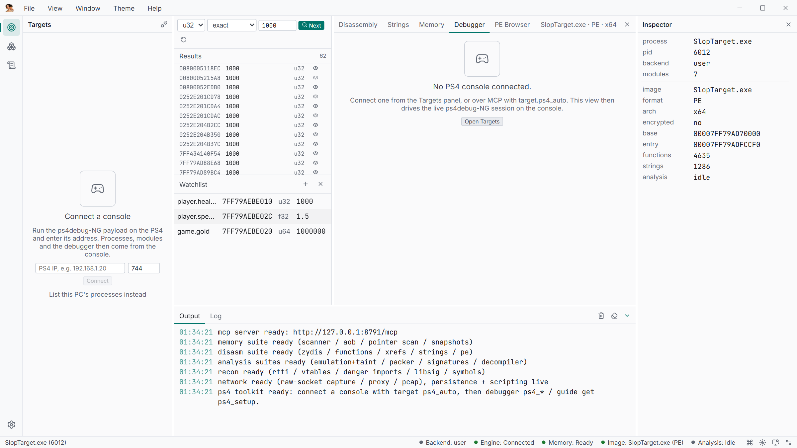

# Live debugging

The `debugger` tool drives the console's ps4debug debugger, and the same tool carries the
`ps5_*` subset for ps5debug-NG. The four one-shot composite flows also run on a local
Windows process (see [A local process, no console](../tutorials/local-process.md)).

| Group | Actions |
| --- | --- |
| Session | `ps4_attach {pid}`, `ps4_detach`, `ps4_status`, `ps4_console_info` (branding, caps, server version, fw, foreground app) |
| Breakpoints | `ps4_bp_set {addr, condition?, hits?}`, `ps4_bp_clear`, `ps4_bp_list` (slots 0–29) |
| Watchpoints | `ps4_watch_set {addr, len, type}`, `ps4_watch_clear`, `ps4_watch_list` (DR0–DR3) |
| Run control | `ps4_continue`, `ps4_step`, `ps4_suspend`/`ps4_resume`, `ps4_process_stop` |
| Events | `ps4_wait {timeout_ms}`, `ps4_events {max, clear}` |
| Registers | `ps4_regs`, `ps4_set_reg`, `ps4_dbregs`, `ps4_set_dbregs`, `ps4_fpregs`, `ps4_set_fpregs`, `ps4_fsgs`, `ps4_set_fsgs` |
| Stack | `ps4_callstack`, `ps4_stack` |
| Remote calls | `ps4_call {addr, args[6]}` — installs the payload RPC stub once per process |
| Power actions | `ps4_until`, `ps4_find_write`, `ps4_trace_calls`, `ps4_trace_steps` |
| Trace sessions | `ps4_trace_start`, `ps4_trace_status`, `ps4_trace_stop` |
| Native scan | `ps4_auth`, then `ps4_scan`, `ps4_rescan`, `ps4_scan_state`, `ps4_scan_reset`, `ps4_scan_all`, `ps4_scan_aob` |

## The basic loop

```json
{ "tool": "debugger", "action": "ps4_attach", "params": { "pid": 1234 } }
{ "tool": "debugger", "action": "ps4_bp_set", "params": { "addr": "0x484490" } }
{ "tool": "debugger", "action": "ps4_continue", "params": { "stop": 0 } }
{ "tool": "debugger", "action": "ps4_wait", "params": { "timeout_ms": 10000 } }
{ "tool": "debugger", "action": "ps4_regs", "params": { "lwpid": 101 } }
{ "tool": "debugger", "action": "ps4_callstack", "params": { "lwpid": 101 } }
```

Breakpoints are software INT3 slots 0–29; watchpoints are hardware DR0–DR3 with a length of
1, 2, 4 or 8 and a type of `exec`, `write` or `rdwr`. `ps4_wait` blocks for the stop event
on port 755 and returns `rip`, registers and the signal; `ps4_events` drains the queue
non-blocking.

## One-shot flows

```json
{ "tool": "debugger", "action": "ps4_find_write",
  "params": { "addr": "0x200001000", "len": 4, "timeout_ms": 10000 } }
```

`ps4_find_write` arms a write watchpoint, resumes, waits for the hit and returns the event
plus the writer's callstack — the answer to "who changed this value".

| Action | Returns |
| --- | --- |
| `ps4_until {addr, timeout_ms}` | `halted`, stop event, `bp_was_armed`, `skipped_stops` |
| `ps4_find_write {addr, len, timeout_ms, depth}` | `event`, `callstack`, `writer_rip` |
| `ps4_trace_calls {addr, count, timeout_ms}` | `hits[]` with `rip` and the 6 argument registers |
| `ps4_trace_steps {lwpid, count, timeout_ms}` | `steps[]` with `rip` and disassembled text |

`ps4_trace_calls` reports the argument registers in SysV order (`rdi, rsi, rdx, rcx, r8,
r9`); a local Win64 target passes `rcx, rdx, r8, r9`. The target stays stopped at the last
hit — `ps4_continue` resumes it.

## Remote calls

```json
{ "tool": "debugger", "action": "ps4_call",
  "params": { "addr": "0x8001234", "args": [1, 2, 3, 0, 0, 0] } }
```

`ps4_call` installs the payload RPC stub once per process (`CMD_PROC_INTALL`) and calls the
address with up to six arguments, returning `rax`. Use it to invoke game functions, resolve
exports via module base + offset, or run shellcode you wrote with `memory.alloc` +
`memory.write`.

## Registers and stack

`ps4_regs` returns the full general-purpose set, `ps4_fpregs` the FP/SIMD state,
`ps4_fsgs` the FS/GS bases, `ps4_dbregs` the debug registers. `ps4_callstack` walks the
`rbp` chain through live reads; `ps4_stack` dumps raw stack memory.

## Trace sessions

The one-shot flows stop at a fixed count. A trace session runs in the background and
streams records to a JSONL file instead:

```json
{ "tool": "debugger", "action": "ps4_trace_start",
  "params": { "mode": "calls", "addr": "0x484490", "path": "C:/tmp/trace.jsonl",
              "ring_size": 4096, "count": 0, "timeout_ms": 5000 } }
{ "tool": "debugger", "action": "ps4_trace_status", "params": {} }
{ "tool": "debugger", "action": "ps4_trace_stop", "params": {} }
```

`mode` is `steps` or `calls` (`calls` takes `addr`, `steps` takes `lwpid`); `path` is
required. Records stay in the ring buffer until `ps4_trace_stop` — or `count` — flushes them
to `path`; `ps4_trace_status` previews the newest eight and reports `records`, `buffered`,
`dropped`, `stop_reason` and `flushed`. Only one trace runs at a time.

## PS5

The `debugger` tool drives a PS5 the same way through ps5debug-NG; connect with
`target.ps5_connect {host}` (or `ps5_auto`) first. The subset is
`ps5_status`, `ps5_console_info`, `ps5_attach`, `ps5_detach`, `ps5_threads`, `ps5_app`,
`ps5_bp_set`/`ps5_bp_clear`/`ps5_bp_list`, `ps5_watch_set`/`ps5_watch_clear`/`ps5_watch_list`,
`ps5_continue`/`ps5_step`/`ps5_suspend`/`ps5_resume`, `ps5_wait`/`ps5_events`,
`ps5_regs`/`ps5_set_reg`, `ps5_notify` and `ps5_print`. There is no PS5 remote call, trace
session or native scan; `target.ps5_notify {msg}` shows an on-screen notification.

## The Debugger view



The **Debugger** tab shows the same state: a **Continue** button, a step control
(*Step one lwp (0 = all threads)*), a wait button, **Detach**, the register and callstack
columns, **Breakpoints** and **Watchpoints (DR)** lists with address/type/length inputs, the
event feed, and the dump row (**dump+load**). Before a console is attached it offers
**Attach debugger (ps4debug)**.
