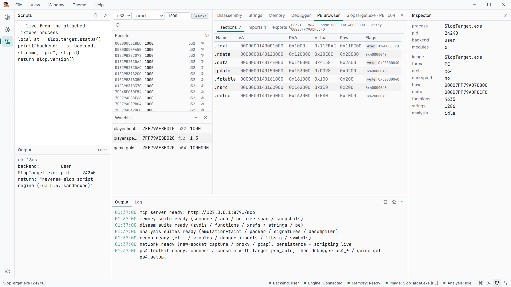

# Lua scripting

Scripts run from the **Scripts** panel (`Ctrl+Enter`), the `script` MCP tool
(`action=run`, `code`, `timeout_ms`) or `/api`, against the same session as the UI —
renames and comments made in one surface show up in all of them. Returned values are
appended as `return: <value>`.

Scripts are sandboxed by default (no `io`/`os` execution, memory and instruction caps);
set `script_unsafe` in Settings for the full standard library.

```lua
-- read the player struct on the console, then rank the dump's functions
local st = slop.target.status()
print("backend:", st.backend, st.name, st.pid)
local raw = slop.mem.read_bytes(0x200001000, 12)         -- raw bytes
local hp, ammo, lives = string.unpack("<i4i4i4", raw)
print("player: hp=" .. hp .. " ammo=" .. ammo .. " lives=" .. lives)

-- the debugger surface is scriptable too
slop.ps4.attach(st.pid)
slop.ps4.bp_set(0x484490)
local ev = slop.ps4.wait(5000)
print(("stop: rip=0x%X thread=%s"):format(ev.rip, ev.thread))

local fns = slop.disasm.functions(4000)
table.sort(fns, function(a, b) return a.size > b.size end)
for i = 1, 5 do
  print(string.format("%X  %s  %d bytes", fns[i].va, fns[i].name, fns[i].size))
end
```



## API surface

| Group | Functions |
| --- | --- |
| Core | `slop.version()`, `slop.log(msg)` |
| Target | `slop.target.list()`, `attach(pid)`, `status()` |
| Memory | `slop.mem.read_hex(addr, len)`, `write_hex(addr, data)`, `scan(...)` |
| Image session | `slop.image.load(path[, base])`, `load_from_target`, `unload`, `status`, `wait_ready([ms])` |
| Instructions | `slop.disasm.decode(addr[, count])`, `bytes(addr[, len])`, `disassemble(...)` |
| Functions / xrefs | `slop.disasm.functions([limit])`, `function_at(va)`, `xrefs_to(va)` |
| Data | `slop.disasm.strings([min[, limit]])`, `slop.disasm.pe()` |
| Annotation | `slop.disasm.name/set_name/comment/set_comment`, `bookmark_toggle`, `bookmarks` |
| Decompiler | `slop.decomp.decompile(va)`, `blocks(va)`, `vtables()`, `globals()`, `rtti()` |
| Analysis | `slop.analyze.packer()` |

## Limits

- `timeout_ms` defaults to 5000 and is clamped to 10..60000; the deadline and MCP
  cancellation are checked every 1000 VM instructions and inside blocking calls
  (`wait_ready`, `mem.scan`, debugger waits are cut to the remaining budget).
- The Lua heap is capped at 256 MiB; `peak_mem` reports usage.
- `print()` output is captured (capped at 4 MiB, `output_truncated=true` past it).
- Scripts never hold a tool lock, so a long script cannot wedge the UI or other agents.

## Examples in the repo

[`examples/`](https://github.com/NetVar1337/SlopStation/tree/main/examples) has runnable
scripts: `ps4_find_value.lua`, `ps4_eboot_overview.lua`, `ps4_breakpoint_trace.lua`,
`ue5_dumper.lua`.
