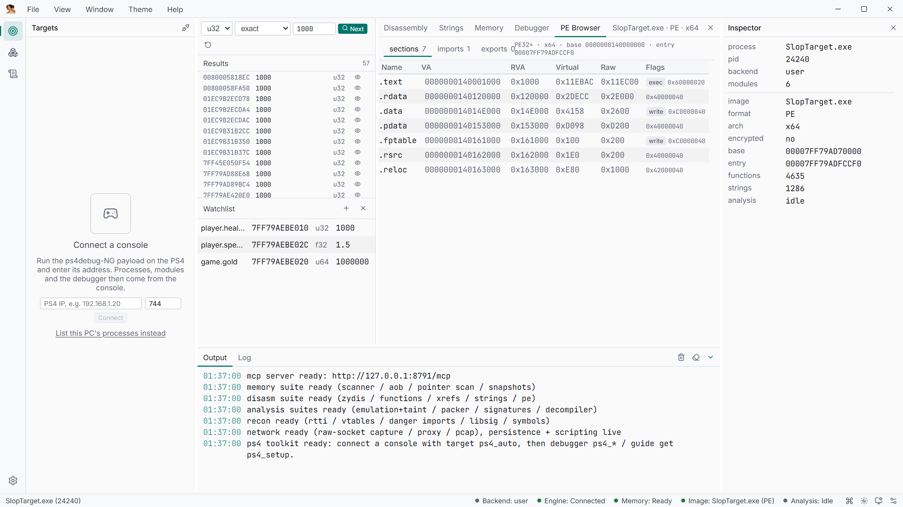

# Static analysis

The image session is shared by the UI, MCP and Lua. One binary loaded once; every surface
sees the same functions, names, comments and patches.

## Formats

- ELF64 with **NID→name resolution** (built-in database, overridable via
  `%LOCALAPPDATA%\reverse-slop\nids.txt`) and relocation application.
- SELF header/segment extraction (fake-signed/unencrypted; an encrypted retail
  `eboot.bin` fails and points at `target.ps4_dump_module`).
- PE headers/imports/exports; Mach-O thin/FAT and `.ipa`; .NET metadata.
- Fast Zydis function, xref and string indexes; Capstone for ARM64.

## What the session holds

- Background Hyperion analysis (CFGs, globals, vtables, RTTI, names) and the decompiler for
  PE and Mach-O images; .NET assemblies list types, render C#, or dump IL.
- **Xray** (read-only): CFG and cyclomatic complexity, control-flow flattening and
  obfuscation scoring, string reconstruction, indirect-call recovery, anti-analysis
  patterns, hook checks, direct syscalls, API-hash resolution, entropy windows, page
  classification, crypto constants, ROP gadgets.
- **Patching** (loaded image only): junk-NOP cleanup, opaque predicates, anti-debug, XOR
  unpack, string decoding, byte writes, a patch journal with full revert, a combined pass,
  and re-indexing after edits.
- Binary-to-binary function diff, packer/protector indicators, RTTI/vtable recovery,
  dangerous-import callsites, library signatures, user structs/enums, comments and
  bookmarks. Names/comments/bookmarks persist per file hash and remap across bases.

## Loading

```json
{ "tool": "disasm", "action": "load", "params": { "path": "C:/dumps/eboot.bin.elf" } }
{ "tool": "disasm", "action": "loaded", "params": {} }
```

`load` takes `base` (rebase the image to a runtime base, 0 keeps its own) and `relocate`
(default true; pass `false` for memory dumps, whose bytes are already relocated). Poll
`loaded` until `image.hype.ready` before using the decompiler or the analyzer database.
`analyze_stop` cancels a background analysis cooperatively (it returns fast when the
analysis already finished), and `unload` drops the session.

`load_self {path, decrypted_dump?}` inspects a PS4 SELF: retail `eboot.bin`/`.sprx`
segments are encrypted with keys that never leave the console, so the action either loads
the decrypted dump you point it at or explains how to get one
(`target.ps4_dump_module` from live memory, or fpkg tooling).

In the app, opening a file is the same call. The **Image Browser** tab shows sections,
imports and exports.



## Indexes

| Action | Returns |
| --- | --- |
| `functions {limit, offset, filter}` | `va`, `name`, `size`, CFG stats |
| `xrefs {addr, limit}` | references to an address, with the engines that found them |
| `strings {min, limit}` | string index with addresses |
| `symbols {limit}` | user renames + analyzer names, with `source` |
| `symbol_set {addr, name}` | write a user rename (empty clears) |
| `blocks {addr}` | basic blocks of a function |
| `globals`, `vtables` | analyzer databases |
| `pe`, `managed` | headers/imports/exports, .NET metadata |
| `disassemble {addr, count}`, `assemble {asm, base, syntax}` | instruction text both ways |

## Annotations and structs

`notes.set_comment`/`notes.get_comment`/`notes.comments` and
`notes.bookmark_toggle`/`notes.bookmarks` hold the analyst layer; `notes.export {path}` and
`notes.import {path, merge}` move it as `symbols/<hash>.json` between machines
(`merge` is `ours`, `theirs` or `union`). `types.declare`, `types.create_struct`,
`types.add_member`, `types.remove_struct`, `types.create_enum`/`types.remove_enum`,
`types.read_field` and `types.format_at` describe and read your own structures.

## Binary diff jobs

`analyze.diff {path_a, path_b}` runs two full Hyperion analyses synchronously and can take
a while on large binaries. `analyze.diff_start {path_a, path_b}` returns a job id instead;
poll `analyze.diff_job {id}` for `stage`/`progress` and stop it with
`analyze.diff_cancel {id}`. Up to 32 jobs are tracked.

## Patching

```json
{ "tool": "patch", "action": "write_bytes",
  "params": { "addr": "0x2004DDA48", "hex": "90 90" } }
{ "tool": "patch", "action": "journal", "params": {} }
{ "tool": "patch", "action": "revert_all", "params": {} }
```

Every change is journaled (`va`, `before`, `after`), `revert_all` restores them, and the
indexes rebuild lazily so `functions`/`xrefs`/`strings` stay correct after an edit.

## Walkthrough

[Dump, rename, decompile](../tutorials/dump-rename-decompile.md).
