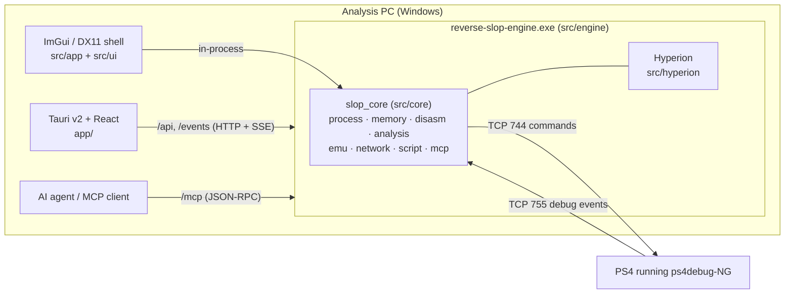

# Architecture



- The Tauri supervisor (`app/src-tauri`) starts the engine as a sidecar, waits for the
  `SLOP_ENGINE_READY <port> <token>` handshake (up to 180 s, covering the UAC prompt),
  holds it in a kill-on-close job object and lets it shut down cleanly. Keeping the engine
  out of the Rust process avoids CRT mixing and isolates crashes.
- Both hosts share the lifecycle in `src/core/infra/lifecycle.cpp`: paths and worker
  queues → process/target services → settings and persistence → MCP/API server and
  onboarding → periodic target/watch/event servicing → orderly shutdown.
- Without a console, the active backend is the Win32 user-mode backend (`OpenProcess` /
  `ReadProcessMemory`) — the same one the test fixture drives.

## Layout

```text
src/
├── app/       Win32 entry + DX11 loop (legacy shell)
├── engine/    headless host and parent-process contract
├── ui/        ImGui chrome, docking, theme, views
├── hyperion/  vendored analysis/decompiler engine (hype namespace)
├── core/
│   ├── infra/     lifecycle, jobs, settings, paths, events, onboarding
│   ├── runtime/   ps4debug-NG backend + Win32 user-mode backend
│   ├── process/   targets, processes, modules, threads, dumps
│   ├── memory/    scanner, AOB, pointer scan, snapshots, watch service
│   ├── debugger/  call-stack unwinding, local Win32 debugger, composite flows
│   ├── disasm/    image loading, Zydis/Capstone indexes, Hyperion bridge
│   ├── analysis/  packer, signatures, xray, patches, devirt, Magicmida
│   ├── emu/       Unicorn execution and taint
│   ├── network/   raw capture, traffic store, proxy, WinHTTP
│   ├── script/    Lua engine
│   ├── mcp/       JSON-RPC/SSE server and the action-based tool surface
│   ├── persist/   SQLite snapshots and key/value storage
│   └── util/      filesystem, zip, PE helpers
├── target/    SlopTarget fixture (test process)
└── tests/     CTest areas and the fake ps4debug-NG server
```

## One session, three surfaces

The engine owns a single active session (target, image, debugger, watchlist). The UI talks
to it over `/api` and `/events`, agents over `/mcp`, scripts through the Lua engine. That is
why a rename made in the Disassembly tab shows up in `disasm.symbols` from an agent, and why
two clients cannot disagree about which process is attached.

## Threading

- One tool mutex serializes tool calls that touch shared state; long-running work
  (emulation, scanning, Hyperion analysis) runs outside it so the UI keeps answering.
- The watch service samples at about 10 Hz on its own tick; the UI never polls.
- The ps4debug debug-event listener drains each TCP 755 connection on its own thread.
