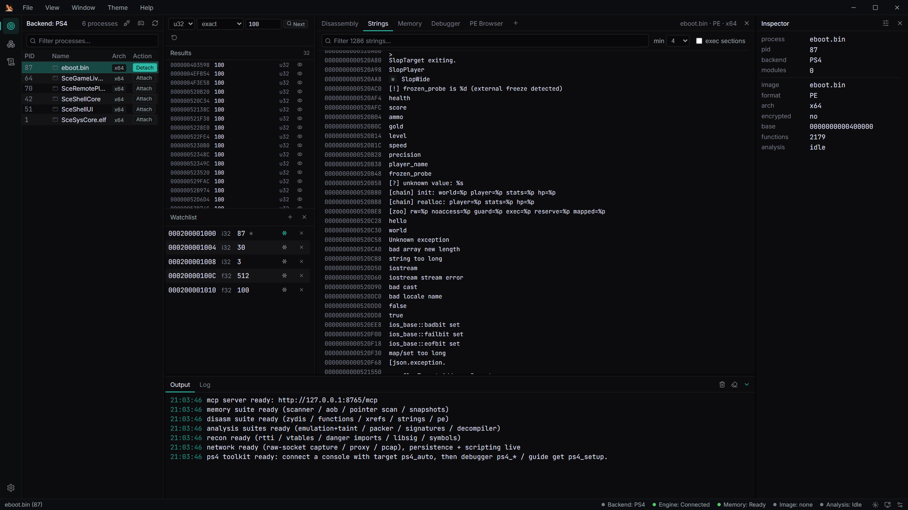
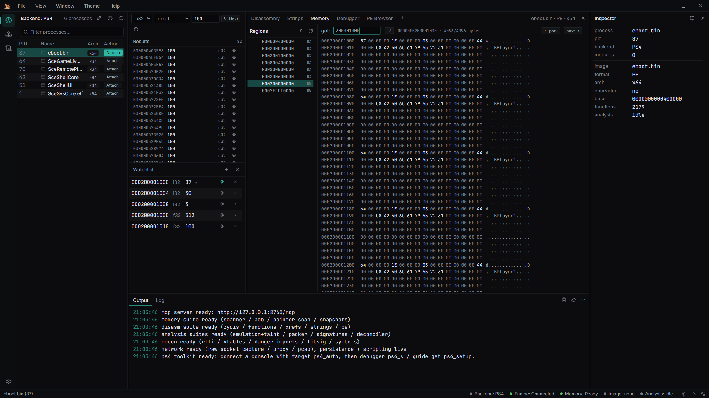
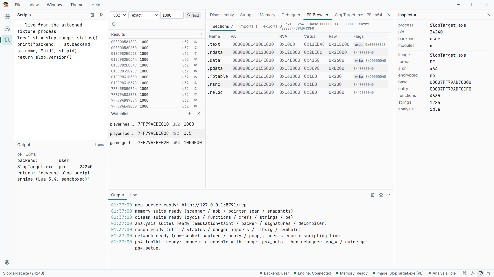
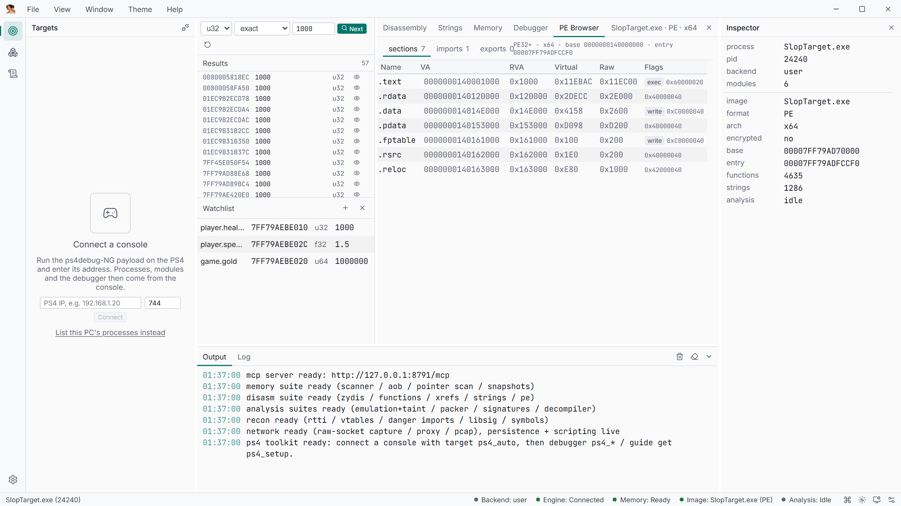
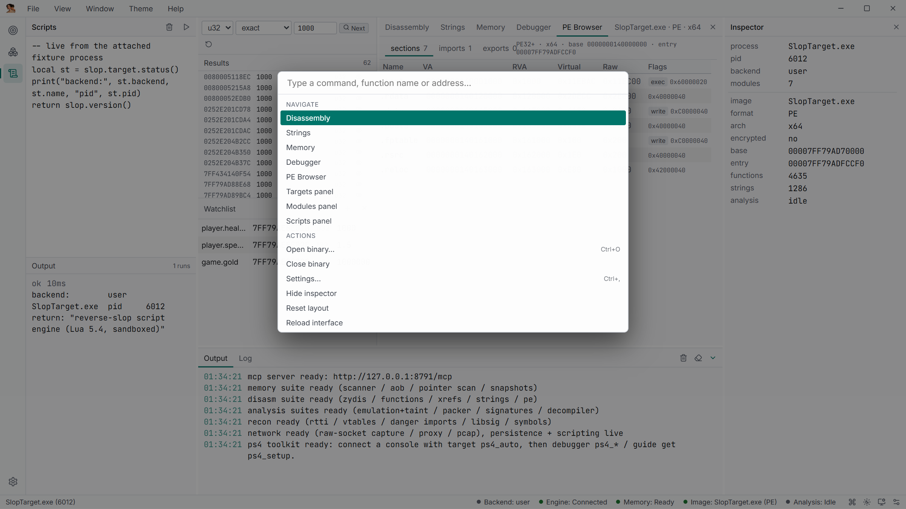
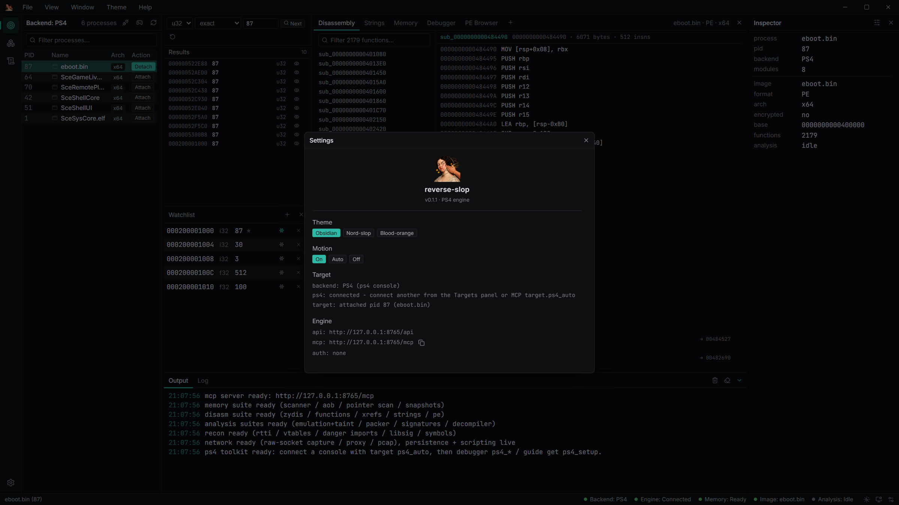
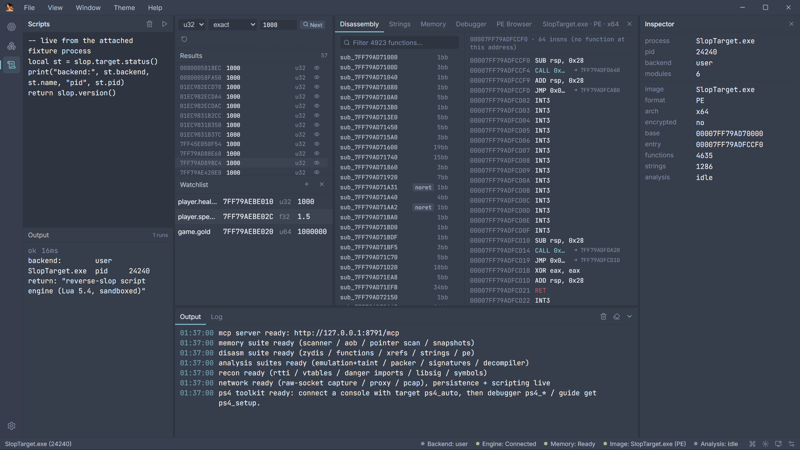
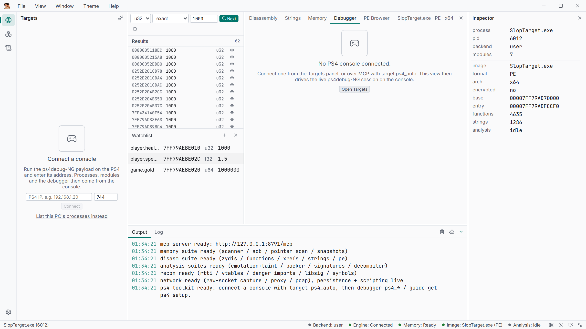

# Screenshots

Every image was captured from the real UI against the bundled `SlopTarget` fixture over the
local user-mode backend — every address and value is genuine runtime data. Console-only
views are shown in their waiting state.

**Workspace** — scanner results, a live watchlist, disassembly and inspector on the bundled
fixture.


<table>
<tr>
<td width="50%"><br><b>Disassembly</b> — virtualized function list with flow-coloured instructions and jump following.</td>
<td width="50%"><br><b>Strings</b> — string index with min-length / exec-section filters; click to follow xrefs.</td>
</tr>
<tr>
<td width="50%"><br><b>Memory</b> — region list and a 4 KiB-paged hex editor, editable in place.</td>
<td width="50%"><br><b>Lua scripts</b> — scratchpad (<code>Ctrl+Enter</code>) against the same session as the UI and MCP.</td>
</tr>
<tr>
<td width="50%"><br><b>PE browser</b> — sections, imports, exports of the loaded image.</td>
<td width="50%"><br><b>Command palette</b> — <code>Ctrl+K</code> jumps to functions, addresses, tabs and actions.</td>
</tr>
<tr>
<td width="50%"><br><b>Settings</b> — theme, motion, engine endpoints, MCP token policy, updates, Lua sandbox.</td>
<td width="50%"><br><b>Themes</b> — Nord-slop shown; also Obsidian (default), Blood-orange, Daylight, High-contrast.</td>
</tr>
<tr>
<td width="50%"><br><b>Debugger</b> — registers, callstack, breakpoints, watchpoints and the event feed once a console is attached.</td>
</tr>
</table>

## Regenerating

```powershell
powershell -File tools/build.ps1 -NoFrontend   # engine + fixture
cd app; npm install
cd e2e; npm install                            # playwright-core
powershell -File tools/screenshots.ps1
```

`tools/screenshots.ps1` wraps `node app/e2e/run.mjs screenshots`, which spawns the engine
and the fixture, starts the Vite dev server, drives headless Chrome/Edge and writes
`docs/screenshots/*.png`. It hides the real host process list before capturing.
