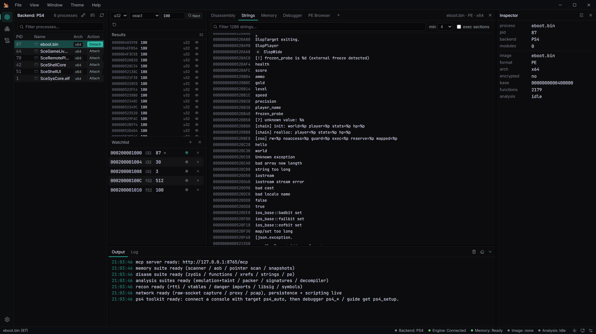

# Tutorial: dump a module, rename it, decompile it

Goal: take a game module off a live console, turn it into a loadable ELF, and work on it
with the static tools — function index, xrefs, strings, renames, comments, the decompiler,
Xray passes and patching with a journal.

Prerequisite: a connected console with an attached process
([First console connect](first-console-connect.md)).

## 1. Dump the module

From the UI: **Debugger** → the dump row at the bottom. Type the module name in
**Module to dump** (`eboot.bin` by default), pick an output path with the folder button
(**Dump output path**), then press **dump+load**.

From an agent, the same thing in one call:

```json
{ "tool": "target", "action": "ps4_dump_module",
  "params": { "name": "eboot.bin", "path": "C:/dumps/eboot.bin.elf", "load": true } }
```

What the parameters mean:

| Parameter | Default | Meaning |
| --- | --- | --- |
| `name` or `base` | — | module to dump, by exact name or by runtime base (one is required) |
| `path` | — | output file (required) |
| `format` | `elf` when `load` is true, else `raw` | `raw` is the mapped span with gaps zero-filled; `elf` rebuilds an ELF64 with one `PT_LOAD` per console segment at its runtime VA |
| `load` | `false` | load the result into the shared image session as soon as it is written |
| `strict` | `false` | fail on unreadable pages instead of zero-filling them |

`load: true` requires `format: "elf"` — a raw span has no ELF headers to load. The engine
loads the dump at the module's runtime base and **does not** apply relocations, because the
bytes were already relocated in memory.

The reply tells you what happened:

```json
{ "dumped": true, "complete": true, "format": "elf", "path": "C:/dumps/eboot.bin.elf",
  "bytes_written": 41943040, "segment_count": 3, "loaded": true,
  "module": { "base": "0x200000000", "name": "eboot.bin", "path": "/app0/eboot.bin" },
  "warnings": [] }
```

`complete: false` means some pages could not be read and were zero-filled — the analysis is
still usable, but code in those pages is missing. `loaded: false` comes with a `load_note`
explaining why.

## 2. Wait for analysis, then look at functions

```json
{ "tool": "disasm", "action": "loaded", "params": {} }
```

Poll until `image.ready` and `image.hype.ready` are true; the decompiler and the analyzer
database need the background Hyperion pass. `image.format` is `elf` for a dump.

```json
{ "tool": "disasm", "action": "functions", "params": { "limit": 50, "filter": "player" } }
```

`functions` returns `va`, `name`, `size`, plus Hyperion's CFG stats once analysis is done.
`filter` matches names and addresses (`0x4DDA48` and `4dda48` both work), `limit` is capped
at 10000.

In the UI the same list is the **Disassembly** tab: virtualized, flow-coloured, click a
row to follow jumps.


## 3. Strings and xrefs

```json
{ "tool": "disasm", "action": "strings", "params": { "min": 6, "limit": 200 } }
{ "tool": "disasm", "action": "xrefs", "params": { "addr": "0x2004DDA48", "limit": 100 } }
```

`strings` takes a minimum length and an exec-section filter; `xrefs` answers "who
references this address" from the Hyperion database, augmented on x86/x64 with the legacy
index and a RIP-relative `LEA` sweep, and reports which engines contributed.

The **Strings** tab is the same index with min-length and exec-section filters; click a
string to follow its xrefs.



## 4. Rename and comment

Rename a function in the UI: double-click its name in the Disassembly list (or select it
and press `F2`), type, `Enter`. The rename is saved and every surface sees it.

From an agent:

```json
{ "tool": "disasm", "action": "symbol_set",
  "params": { "addr": "0x2004DDA48", "name": "Player::apply_damage" } }
```

`symbol_set` writes a **user** symbol; an empty `name` clears it. `disasm.symbols` lists
user renames next to analyzer names with `source: "user" | "hyperion"`, and user names win.
Renames persist per file hash, so they survive a reload and remap across bases.

Comments are an API/Lua surface (neither desktop shell renders them yet):

```json
{ "tool": "notes", "action": "set_comment",
  "params": { "addr": "0x2004DDA48", "text": "called from the damage path" } }
{ "tool": "notes", "action": "comments", "params": {} }
```

`notes.bookmark_toggle` / `notes.bookmarks` do the same for bookmarks. Both persist per
file hash like renames.

## 5. Decompile

```json
{ "tool": "decomp", "action": "function", "params": { "addr": "0x2004DDA48" } }
```

`decomp.function` waits up to 10 s for the Hyperion analysis, then returns C-like output
lifted through p-code, SSA, DCE, type inference and structuring. It fails clearly when the
image has no Hyperion engine (unsupported format) or the analysis errored — re-run
`disasm.load` to restart it.

Related calls on the same database:

```json
{ "tool": "decomp", "action": "function", "params": { "addr": "0x2004DDA48" } }
{ "tool": "disasm", "action": "blocks", "params": { "addr": "0x2004DDA48" } }
{ "tool": "disasm", "action": "globals", "params": {} }
{ "tool": "disasm", "action": "vtables", "params": {} }
```

## 6. Xray passes

Xray is read-only and works on the loaded image. The useful ones on a fresh dump:

```json
{ "tool": "xray", "action": "obfuscation", "params": {} }
{ "tool": "xray", "action": "cff", "params": {} }
{ "tool": "xray", "action": "strings_recon", "params": {} }
{ "tool": "xray", "action": "indirect_calls", "params": {} }
{ "tool": "xray", "action": "gadgets", "params": {} }
```

| Action | Answers |
| --- | --- |
| `cfg`, `complexity` | control-flow graph and cyclomatic complexity |
| `cff` | control-flow flattening detection |
| `obfuscation` | aggregate obfuscation score |
| `strings_recon` | reconstructed stack/immediate strings |
| `indirect_calls` | recovered indirect-call targets |
| `anti_analysis` | anti-debug/anti-VM patterns (PE only) |
| `hooks`, `syscalls` | inline hooks and direct syscalls |
| `apihash` | API-hash resolution |
| `entropy`, `pages`, `crypto_range` | entropy windows, page classification, crypto constants |
| `gadgets` | ROP gadgets |

## 7. Patch, and keep the journal

Patching works on the loaded image only, and every byte change is journaled so it can be
reverted.

```json
{ "tool": "patch", "action": "nop_junk", "params": { "addr": "0x2004DDA48" } }
{ "tool": "patch", "action": "journal", "params": { "limit": 100 } }
{ "tool": "patch", "action": "revert_all", "params": {} }
```

`journal` returns `patches[]` (`va`, `before`, `after`), `total` and `indexes_dirty`.
`revert_all` restores every recorded byte. The indexes rebuild lazily after a patch, so
`disasm.functions`/`xrefs`/`strings` stay correct.

Other passes: `resolve_opaque`, `patch_antidebug` (PE), `unpack_xor`, `decode_strings`,
`write_bytes {addr, hex}`, `full_pass` (combined, reports the obfuscation-score reduction),
`rebuild` (re-disassemble after edits).

## 8. Keep going

- [Static analysis](../features/static-analysis.md) — the full picture of what the image
  session holds.
- [Decompiler](../features/decompiler.md) — what the output means.
- [Live memory](../features/live-memory.md) — take an address from the dump back to the
  running game.
