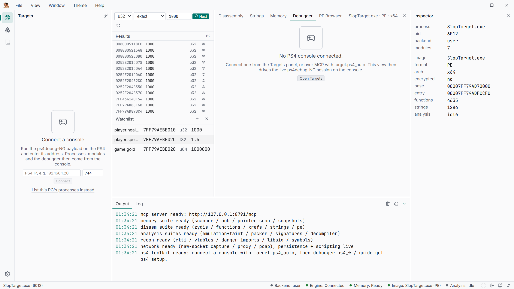

# Tutorial: first console connect

Goal: from a cold start to a live, debuggable game process on a PS4 you own, and know what
each failure looks like.

What you need:

- A PS4 on the same LAN, jailbroken, with GoldHEN (or any loader) available.
- SlopStation installed or built (see [Install](../getting-started/install.md)).
- The console IP. If you do not know it, **Discover** will find it.

## 1. Open Targets

Launch the app. With no console connected the Targets panel shows the empty state
**Connect a console** with the connect form and the *ps4debug-NG payload* card below it.


## 2. Get the payload onto the console

The payload is ps4debug-NG, the program the engine talks to over TCP 744. The app ships a
copy; the card shows its tag (`v<tag>`) and where it came from.

Two ways to get it running:

**Send it over BinLoader.** GoldHEN listens for a payload on TCP 9090. The card's port
field defaults to `9090`; press **Send to console**. The engine opens one fresh TCP
connection, streams the raw `.bin` and closes it. The card reports
`Sent <bytes> bytes to <host>:<port>.` The loader then executes the payload, which starts
listening on 744.

**Save it and load it yourself.** **Save payload…** writes the `.bin` wherever you want —
FTP it to `/data/` and load it with a payload manager, or use a GoldHEN `/data/payload.bin`
autoload. The same bytes work either way.

If the bundled build is older than the newest GitHub release, **Check latest** compares
them and shows **Download v\<tag\>**; downloading stores it under
`%LOCALAPPDATA%\dev.slopstation.ui\payloads\ps4debug-ng\`.

The same steps from an agent:

```json
{ "tool": "target", "action": "ps4_send_payload",
  "params": { "host": "192.168.1.50", "port": 9090 } }
```

`path` is optional — without it the engine uses the bundled payload next to the executable
or in the app data directory. The payload must be ≤ 64 MiB (it is ~1 MiB).

## 3. Discover the console

Press **Discover** in the connect form. The engine broadcasts the 4-byte magic
`0xFFFFAAAA` to `255.255.255.255:1010` and collects every payload that answers with the
same magic (the ps4debug-mcp discovery convention). Answers fill the IP field; when more
than one console answers, each is offered as a link button.

```json
{ "tool": "target", "action": "ps4_discover", "params": { "timeout_ms": 2000 } }
```

returns `found`, `consoles[]` and the probe it used. `timeout_ms` defaults to 2000 and is
capped at 60000.

Discovery is a convenience, not a requirement: type the IP and skip it.

## 4. Connect

Enter the IP (the field is labelled **PS4 IP address**, default port `744`) and press
**Connect**. The engine opens the command connection, reads the payload version and
branding, and starts the debug-event listener on 755.

When it works the panel switches to **PS4 processes** with a banner showing the endpoint
and the payload branding, plus a **Disconnect** button. The list is the console's process
table: PID, name, arch, and an attach action per row.

One call does connect + process pick + attach + debug attach:

```json
{ "tool": "target", "action": "ps4_auto", "params": { "host": "192.168.1.50" } }
```

`ps4_auto` enumerates processes, marks each one that has a module under `/app0/` as a game,
prefers the one whose name contains `eboot`, attaches a session and the ps4debug debugger,
and returns `pid`, `name`, `debug_attached`, `candidates[]`, `modules[]`, `threads[]` and
`region_count`. If nothing has `/app0/` modules it falls back to the process with the
largest total module size and sets `heuristic_pick: true` — check `candidates` before
trusting it.



## 5. Confirm you are live

```json
{ "tool": "debugger", "action": "ps4_status", "params": {} }
```

`debug_attached: true` and a `debug_pid` mean breakpoints, watchpoints and steps work.
Then:

```json
{ "tool": "target", "action": "modules", "params": {} }
{ "tool": "memory", "action": "read", "params": { "addr": "0x200001000", "len": 64 } }
```

Reads are validated against the console's VM map, so an unmapped address fails instead of
returning zeros. Everything else — scanning, the decompiler on live addresses, the
debugger — follows from here: see [Live memory](../features/live-memory.md),
[Live debugging](../features/live-debugging.md) and
[On-console tooling](../features/on-console-tooling.md).

## Troubleshooting

| Symptom | Cause | Fix |
| --- | --- | --- |
| **Discover** says *No console answered the discovery probe.* | The payload is not running, has no discovery listener, or the PC is on another subnet/VLAN | Load ps4debug-NG first; type the IP manually if discovery is blocked |
| `connect to <ip>:744 timed out` | Nothing is listening on 744 — payload not loaded, or it crashed | Re-send the payload; check the console's loader log |
| `connect to <ip>:744 failed (WSA …)` | Refused or unreachable | Wrong IP, console asleep, or a firewall between the hosts |
| **Send to console** fails with `connect … :9090` | BinLoader is not listening (GoldHEN not running, or a different loader port) | Start GoldHEN, or change the port field to your loader's port |
| **Send to console** fails with `no payload found` | No bundled payload next to the engine and none downloaded | **Check latest → Download v\<tag\>**, or pass an explicit `path` |
| Connected, but the process list is empty | The payload answered the handshake but the process command failed | Check `debugger.ps4_status` for `fw`; a mismatched payload build can reject commands |
| `ps4_dump_module requires a connected console with an attached process` | The console is connected but no process is attached | Attach a row in Targets, or `target.ps4_connect {host, pid}` |
| Debug attach fails (`debug_attached: false`, `debug_error` set) | The payload refused `CMD_DEBUG_ATTACH`, often because another debugger holds the process | Detach the other debugger (or restart the game), then `ps4_reconnect` |
| Connection drops mid-session | Payload restart, console sleep, or Wi-Fi | `target.ps4_reconnect` — the engine resets debug and turbo-scan sessions and says so in the error text |
| Windows Firewall prompt on first run | The engine listens on 127.0.0.1 and opens outbound sockets | Allow it on private networks; inbound access is not needed for console work |

The debug-event listener on 755 accepts only the console you attached, and each connection
is drained on its own thread, so a stale connection from a previous session cannot inject
events.
